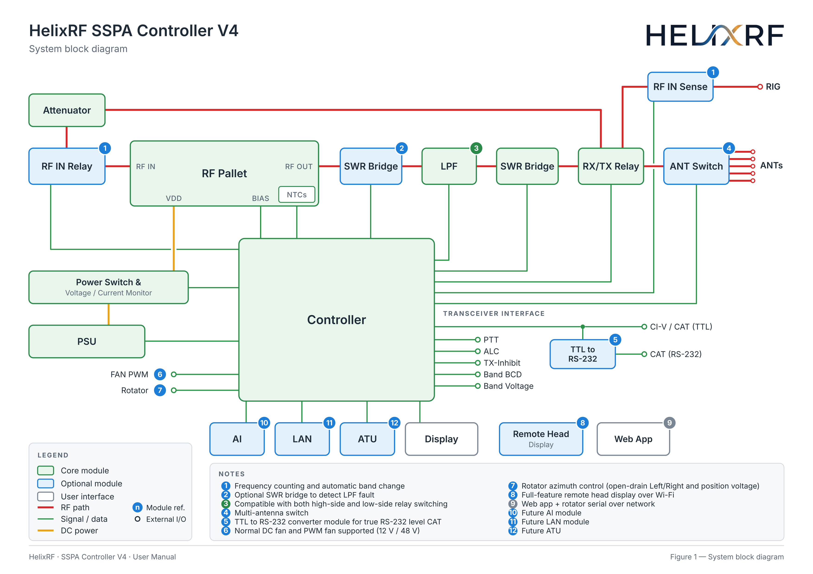
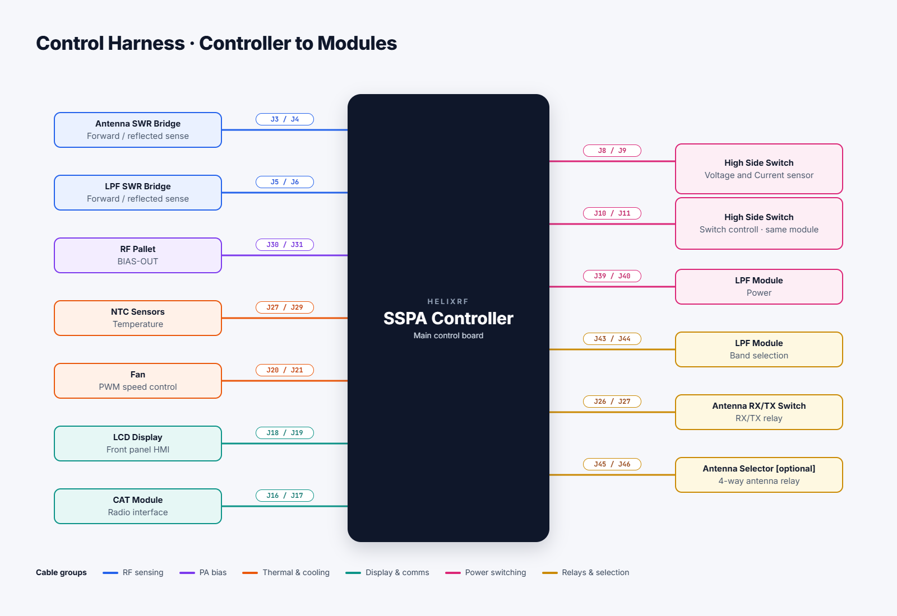
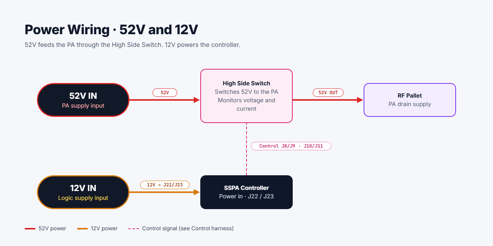
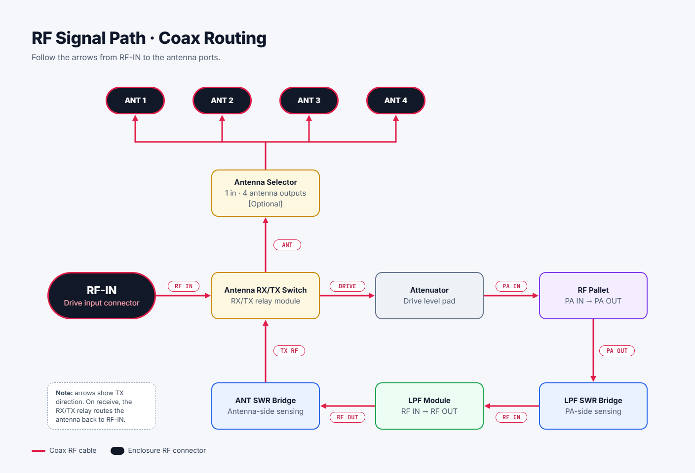
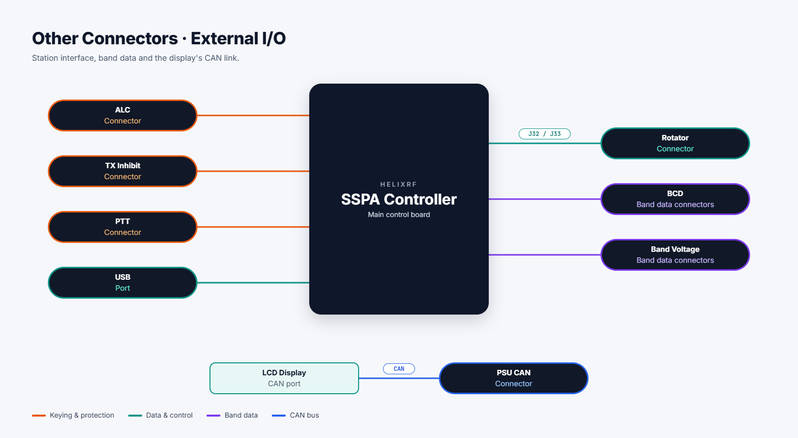

# Connectors and wiring

Every connector on the controller board, what it does, its pin-out and how to
wire it. Pin numbers follow the board silkscreen; pin 1 is GND on almost
every connector.

--8<-- "safety-rf.md"

!!! info "Two footprints per connector"
    Most connectors appear twice on the board under two reference numbers, for
    example **J3 / J4**. The first is a **JST PH (2.0 mm) side-entry socket**,
    the second is a row of **solder pads** wired in parallel. Use whichever
    suits your build: a crimped JST PH lead, or wires soldered straight to the
    pads. Never use both at once.

## Overview

The diagrams below show the whole system: the block diagram first, then the
harness, power, RF and I/O wiring. The sections after them cover
each connector in detail.

=== "System"

    { loading=lazy }

    [Download the PDF](../assets/wiring/helixrf-sspa-v4-block-diagram.pdf) for printing.

=== "Control harness"

    { loading=lazy }

=== "Power"

    { loading=lazy }

=== "RF path"

    { loading=lazy }

=== "Other I/O"

    { loading=lazy }

### Connector index

| Connector | Name on board | Connects to | Section |
| --- | --- | --- | --- |
| J22 / J23 | 12V | 12 V logic supply | [Power in](#j22-j23-12-v-power-in) |
| J39 / J40 | LPF PWR | LPF module supply | [LPF power](#j39-j40-lpf-module-power) |
| J8 / J9 | PSU-MON | High Side Switch, voltage and current sense | [PSU monitor](#j8-j9-psu-monitor) |
| J10 / J11 | PSU-PROT | High Side Switch, on/off control | [PSU protection](#j10-j11-psu-protection) |
| J30 / J31 | BIAS | RF pallet bias | [PA bias](#j30-j31-pa-bias) |
| J3 / J4 | ANT SWR | Antenna-side SWR bridge | [SWR bridges](#j3-j4-and-j5-j6-swr-bridges) |
| J5 / J6 | LPF SWR | PA-side (LPF) SWR bridge | [SWR bridges](#j3-j4-and-j5-j6-swr-bridges) |
| J28 / J29 | NTC | Two temperature sensors | [Temperature](#j28-j29-ntc-temperature-sensors) |
| J20 / J21 | FAN | Cooling fan | [Fan](#j20-j21-fan) |
| J41 / J42, J43 / J44 | ~LPF, LPF | LPF band relays | [LPF band select](#j41-j42-and-j43-j44-lpf-band-select) |
| J45 / J46 | ANT | Antenna selector relays | [Antenna selector](#j45-j46-antenna-selector) |
| J26 / J27 | PTT | Radio PTT in, RX/TX relay out | [PTT and RX/TX relay](#j26-j27-ptt-and-rxtx-relay) |
| J24 / J25 | ALC | Radio ALC and TX inhibit | [ALC and TX inhibit](#j24-j25-alc-and-tx-inhibit) |
| J1 / J2 | BAND SELECT | Radio band data, RF sense | [Band data](#j1-j2-band-data-and-rf-sense) |
| J16 / J17 | CAT | CAT / CI-V | [CAT](#j16-j17-cat-ci-v) |
| J18 / J19 | 3V3 UART1 | Touch display | [Display](#j18-j19-display) |
| J32 / J33 | ROT | Antenna rotator | [Rotator](#j32-j33-rotator) |
| J34 | USB-C | PC (service and recovery) | [USB](#j34-usb-c) |
| J14 / J15 | FREQ-CNT | Frequency counter / drive protection | [Expansion](#expansion-and-service-connectors) |
| J12 / J13 | I2C | Expansion | [Expansion](#expansion-and-service-connectors) |
| J35 / J36 | NEURAL | HelixRF Neural module | [Expansion](#expansion-and-service-connectors) |
| J37 / J38 | OTA | Boot and reset lines | [Expansion](#expansion-and-service-connectors) |
| J7 | SWD | Programmer / debugger | [Expansion](#expansion-and-service-connectors) |

---

## Power

### J22 / J23 · 12 V power in

The 12 V logic supply for the controller, the display, the fan and all relay
outputs.

| Pin | Signal | Direction | Notes |
| --- | --- | --- | --- |
| 1 | GND | | |
| 2 | +12 V | In | 12–14 V DC (13.8 V is fine). Do not exceed 15 V. |

The input is protected by a 5 A resettable fuse (F1) and a reverse-polarity
diode: connected the wrong way round, the fuse trips and the board stays off.
Size the supply for the board and display plus your fan and every relay coil
that can be on at the same time (one LPF relay, up to four antenna relays and
the RX/TX relay).

```text
 12 V supply                       Controller J22
 ┌─────────┐                       ┌──────────┐
 │    +12V ├───────────────────────┤ 2  +12V  │
 │     GND ├───────────────────────┤ 1  GND   │
 └─────────┘                       └──────────┘
```

!!! warning
    The 52 V PA supply never goes to the controller board. It runs through the
    High Side Switch module (see the **Power** diagram above).

### J39 / J40 · LPF module power

Supplies 12 V to the LPF relay board. Two pins per rail share the current.

| Pin | Signal | Direction |
| --- | --- | --- |
| 1, 2 | GND | |
| 3, 4 | +12 V | Out |

```text
 Controller J39                     LPF module
 ┌──────────┐                      ┌──────────┐
 │ 3,4 +12V ├──────────────────────┤ +12V     │
 │ 1,2 GND  ├──────────────────────┤ GND      │
 └──────────┘                      └──────────┘
```

### J8 / J9 · PSU monitor

Voltage and current readings from the High Side Switch module, shown on the
display and used by the protection. Pin 4 powers the sensor.

| Pin | Signal | Direction | Notes |
| --- | --- | --- | --- |
| 1 | GND | | |
| 2 | V_SENSE | In | PA supply voltage, scaled by the module |
| 3 | I_SENSE | In | PA current: shunt amplifier, Hall sensor or BTS current-sense output |
| 4 | +3.3 V | Out | Supply for the sensor |

The sensor type (shunt, Hall or BTS) and its values are set on the display.
See [Power module](../setup/index.md#power-module-current-sensor).

```text
 Controller J8                      High Side Switch (sense)
 ┌───────────────┐                 ┌─────────────────┐
 │ 4  +3.3V      ├─────────────────┤ sensor supply   │
 │ 3  I_SENSE    │◄────────────────┤ current out     │
 │ 2  V_SENSE    │◄────────────────┤ voltage out     │
 │ 1  GND        ├─────────────────┤ GND             │
 └───────────────┘                 └─────────────────┘
```

### J10 / J11 · PSU protection

Turns the 52 V PA supply off when the hardware protection latches a fault.
Pins 2 and 3 are open-drain outputs (MOSFET to GND) with opposite sense, so
the switch module can use whichever its gate driver needs.

| Pin | Signal | Direction | Normal operation | Fault latched |
| --- | --- | --- | --- | --- |
| 1 | GND | | | |
| 2 | ~PROT-VCC | Out | Open | Switched to GND |
| 3 | PROT-VCC | Out | Switched to GND | Open |
| 4 | +3.3 V | Out | Supply for the switch logic | |

- Use **pin 3** for a switch that stays on only while its control input is
  held to GND. This is fail-safe: a broken wire turns the PA supply off.
- Use **pin 2** for a switch that turns off when its control input is pulled
  to GND.

The High Side Switch manual shows which pin it uses.

```text
 Controller J10                     High Side Switch (control)
 ┌───────────────┐                 ┌─────────────────┐
 │ 4  +3.3V      ├─────────────────┤ logic supply    │
 │ 3  PROT-VCC   ├────────────────►│ enable / kill   │
 │ 2  ~PROT-VCC  ├────────────────►│ (use one)       │
 │ 1  GND        ├─────────────────┤ GND             │
 └───────────────┘                 └─────────────────┘
```

---

## PA

### J30 / J31 · PA bias

Switches the pallet's gate bias. The controller applies bias only while
transmitting, after the RX/TX relay has settled (20 ms), and removes it
5 ms before the relay returns to receive. A protection fault removes it at
once, in hardware.

| Pin | Signal | Direction | Notes |
| --- | --- | --- | --- |
| 1 | GND | | |
| 2 | BIAS-IN | In | Bias supply from the pallet, up to 12 V |
| 3 | BIAS-OUT | Out | Switched bias back to the pallet's gate-bias input |
| 4 | Gate kill (optional) | Out | Open drain: pulled to GND while a fault is latched |
| 5 | +12 V | Out | Low-current supply for an external pinch-off circuit |
| 6 | −12 V | Out | Low-current supply for an external pinch-off circuit |
| 7 | PINCH | Out | Logic high (3.3 V) while a fault is latched |
| 8 | BIAS_CTRL | Out | Logic high while transmitting, for pallets with a bias-enable input |

Most LDMOS pallets need only pins 1–3: break the pallet's bias supply line
and route it through BIAS-IN and BIAS-OUT. Pins 4–8 are for pallets that need
a hard gate kill, a negative pinch-off voltage or a separate bias-enable
signal.

```text
 Controller J30                     RF pallet
 ┌───────────────┐                 ┌──────────────────┐
 │ 2  BIAS-IN    │◄────────────────┤ bias supply out  │
 │ 3  BIAS-OUT   ├────────────────►│ gate bias in     │
 │ 4  Gate kill  ├ ─ ─ ─ ─ ─ ─ ─ ─►│ gate (optional)  │
 │ 8  BIAS_CTRL  ├ ─ ─ ─ ─ ─ ─ ─ ─►│ bias enable (opt)│
 │ 1  GND        ├─────────────────┤ GND              │
 └───────────────┘                 └──────────────────┘
       ─── required    ─ ─ optional
```

---

## RF sensing and thermal

### J3 / J4 and J5 / J6 · SWR bridges

DC outputs from the two directional couplers. **J3 / J4** reads the bridge
on the antenna side (after the LPF). **J5 / J6** reads the bridge between
the PA and the LPF, which catches a wrong or failed filter. Both feed the
hardware SWR trips; the antenna bridge also drives the power and SWR meters.

| Pin | Signal | Direction | Notes |
| --- | --- | --- | --- |
| 1 | GND | | |
| 2 | Reflected (ANT-R / LPF-R) | In | DC from the reflected detector |
| 3 | GND | | |
| 4 | Forward (ANT-F / LPF-F) | In | DC from the forward detector |

Use shielded cable or a twisted pair per signal, and keep it away from the
PA output coax.

```text
 SWR bridge                         Controller J3 (antenna) / J5 (LPF)
 ┌──────────────┐                  ┌──────────────┐
 │ FWD detector ├─────────────────►│ 4  FWD       │
 │          GND ├──────────────────┤ 3  GND       │
 │ REF detector ├─────────────────►│ 2  REF       │
 │          GND ├──────────────────┤ 1  GND       │
 └──────────────┘                  └──────────────┘
```

Calibrate the meter after wiring; see
[RF power calibration](../setup/index.md#rf-power-calibration).

### J28 / J29 · NTC temperature sensors

Two NTC thermistors. The fan speed follows whichever reads higher. The
**hardware over-temperature trip watches NTC 1 only**, so mount NTC 1 on the
pallet heatsink, next to the transistor. NTC 2 can go on the LPF, the
combiner or the PSU.

Each NTC sits between +3.3 V and its sense pin; the board has a 10 kΩ
resistor from each sense pin to GND.

| Pin | Signal | Direction | Notes |
| --- | --- | --- | --- |
| 1 | +3.3 V | Out | NTC 1 supply |
| 2 | NTC-1 | In | NTC 1 sense (heatsink; used by the hardware trip) |
| 3 | +3.3 V | Out | NTC 2 supply |
| 4 | NTC-2 | In | NTC 2 sense |

Use 10 kΩ NTCs. The firmware defaults to 10 kΩ at 25 °C and β = 3950, the
values of the common 10 kΩ "3950" thermistor. For a different NTC, enter its
resistance and beta on the display; see
[Temperature and fan](../setup/index.md#temperature-and-fan).

```text
 Controller J28
 ┌──────────────┐        NTC 1 (pallet heatsink)
 │ 1  +3.3V     ├────────/\/\/\────┐
 │ 2  NTC-1     ├──────────────────┘
 │              │        NTC 2
 │ 3  +3.3V     ├────────/\/\/\────┐
 │ 4  NTC-2     ├──────────────────┘
 └──────────────┘
```

### J20 / J21 · Fan

Variable fan speed. The speed ramps from 10 % at the "fan low" temperature to
100 % at "fan high"; the fan never stops completely. Two-wire fans are
switched on their negative lead; four-wire PC fans take the PWM signal.

| Pin | Signal | Direction | Notes |
| --- | --- | --- | --- |
| 1 | GND | | |
| 2 | PWM | Out | PWM control for 4-wire fans |
| 3 | FAN − | Out | Switched negative for 2-wire fans |
| 4 | +12 V | Out | Fan supply (filtered) |

=== "2-wire fan"

    ```text
     Controller J20                 Fan
     ┌──────────────┐              ┌──────────┐
     │ 4  +12V      ├──────────────┤ + (red)  │
     │ 3  FAN −     ├──────────────┤ − (black)│
     └──────────────┘              └──────────┘
    ```

=== "4-wire PC fan"

    ```text
     Controller J20                 Fan
     ┌──────────────┐              ┌──────────────┐
     │ 4  +12V      ├──────────────┤ +12V (yellow)│
     │ 1  GND       ├──────────────┤ GND  (black) │
     │ 2  PWM       ├──────────────┤ PWM  (blue)  │
     └──────────────┘              └──────────────┘
       (tach wire not used)
    ```

If the fan runs backwards to the temperature (fast when cold), turn on
**Invert PWM** on the Temperature page.

---

## Band and antenna switching

### J41 / J42 and J43 / J44 · LPF band select

Eight band outputs to the LPF relay board, one per filter bank. Exactly one
output is on at a time. Which bank each band uses is set in the
[LPF map](../setup/index.md#lpf-map). The outputs are given twice, so you can
use whichever matches your relay board:

- **J43 / J44 (LPF): sourcing.** The active pin goes to +12 V. Wire each relay
  coil between the pin and GND.
- **J41 / J42 (~LPF): sinking.** The active pin goes to GND (open collector).
  Wire each relay coil between +12 V and the pin.

| Pin | J43 / J44 (sourcing) | J41 / J42 (sinking) |
| --- | --- | --- |
| 1 | BAND1 | ~BAND1 |
| 2 | BAND2 | ~BAND2 |
| 3 | BAND3 | ~BAND3 |
| 4 | BAND4 | ~BAND4 |
| 5 | BAND5 | ~BAND5 |
| 6 | BAND6 | ~BAND6 |
| 7 | BAND7 | ~BAND7 |
| 8 | BAND8 | ~BAND8 |

The drivers (A2982 sourcing, ULN2803A sinking) are rated 500 mA per output;
keep each relay coil well below that. The sinking outputs have clamp diodes
on the board. For the sourcing outputs, fit a flyback diode across each relay
coil on the LPF board.

=== "Sourcing (J43)"

    ```text
     Controller J43                 LPF module (one bank shown)
     ┌──────────────┐              ┌────────────────────────┐
     │ 1  BAND1     ├─────────────►│ relay coil ──┐         │
     │ …            │              │              GND       │
     │ 8  BAND8     ├─────────────►│ (one per bank)         │
     └──────────────┘              └────────────────────────┘
     Power the LPF board from J39 (+12 V and GND).
    ```

=== "Sinking (J41)"

    ```text
     Controller J41                 LPF module (one bank shown)
     ┌──────────────┐              ┌────────────────────────┐
     │ 1  ~BAND1    ├──────────────┤ relay coil ── +12V     │
     │ …            │              │                        │
     │ 8  ~BAND8    ├──────────────┤ (one per bank)         │
     └──────────────┘              └────────────────────────┘
     Relay +12 V comes from J39.
    ```

### J45 / J46 · Antenna selector

Drives the optional 4-way antenna selector and a separate receive-antenna
relay. All outputs are sourcing (+12 V when on, A2982 driver, 500 mA per
output). The TX antenna is chosen per band on the display and never changes
while transmitting.

| Pin | Signal | Notes |
| --- | --- | --- |
| 1 | ANT1 | TX antenna relay 1 |
| 2 | ANT2 | TX antenna relay 2 |
| 3 | ANT3 | TX antenna relay 3 |
| 4 | ANT4 | Dedicated RX antenna relay |
| 5–8 | EX1–EX4 | Spare sourcing outputs, not used by firmware 105 |

The TX antenna relays use a cumulative code, so a cascade of three
changeover relays selects four antennas:

| Antenna | ANT1 | ANT2 | ANT3 |
| --- | --- | --- | --- |
| ANT 1 (default, no relay on) | off | off | off |
| ANT 2 | **on** | off | off |
| ANT 3 | **on** | **on** | off |
| ANT 4 | **on** | **on** | **on** |

The RX antenna relay (ANT4) is on only while receiving, with PA ENABLE on,
on a band set to use the RX antenna. It drops the moment the amplifier keys.

J45 has no GND pin. Return the relay coils to GND at the selector board,
taking GND from J39 or the chassis. Fit a flyback diode across each coil.

```text
 Controller J45                     Antenna selector board
 ┌──────────────┐                  ┌─────────────────────────┐
 │ 1  ANT1      ├─────────────────►│ K1 coil ─┐              │
 │ 2  ANT2      ├─────────────────►│ K2 coil ─┤  coils to    │
 │ 3  ANT3      ├─────────────────►│ K3 coil ─┤  GND         │
 │ 4  ANT4 (RX) ├─────────────────►│ RX relay─┘              │
 └──────────────┘                  └─────────────────────────┘
```

---

## Radio interface

### J26 / J27 · PTT and RX/TX relay

Keying input from the radio and the drive for the RX/TX changeover relay. The
controller sequences the relay and the bias so the relay never switches with
RF present.

| Pin | Signal | Direction | Notes |
| --- | --- | --- | --- |
| 1 | GND | | |
| 2 | ~PTT | In | Active low: radio's TX-GND / SEND output pulls it to GND |
| 3 | nRST-RLY | Out | Open drain: pulled to GND for 300 ms when you press PA RESET |
| 4 | RX/TX RLY | Out | +12 V while transmitting; flyback diode on board |

**nRST-RLY** resets external modules that latch their own faults. Wire it to
the module's reset input (active low), or leave it unconnected.

```text
 Radio                Controller J26              RX/TX relay
 ┌──────────┐        ┌──────────────┐            ┌──────────┐
 │ SEND/PTT ├───────►│ 2  ~PTT      │            │          │
 │      GND ├────────┤ 1  GND       ├────────────┤ coil −   │
 └──────────┘        │ 4  RX/TX RLY ├───────────►│ coil +   │
                     └──────────────┘            └──────────┘
```

!!! warning "Test before going on the air"
    Check that the relay changes over on PTT with no RF applied, before you
    connect the drive cable.

### J24 / J25 · ALC and TX inhibit

Protection outputs to the radio. While a fault is latched, the controller
pulls the radio's ALC negative and asserts TX inhibit, so the radio drops its
drive. In normal operation the ALC pins sit at 0 V; they do not regulate
power.

| Pin | Signal | Direction | Notes |
| --- | --- | --- | --- |
| 1 | GND | | |
| 2 | ALC (4 V range) | Out | 0 V normally, about −4 V on a fault |
| 3 | ALC (10 V range) | Out | 0 V normally, about −10 V on a fault |
| 4 | TX-INH | Out | Open drain: switched to GND on a fault |

Use the ALC pin that matches your radio's ALC input range: −4 V for most
current radios, −10 V for older ones. Check your radio's manual. Wire TX-INH
only if your radio has a TX-inhibit input that disables transmit when pulled
to GND.

```text
 Controller J24                     Radio
 ┌──────────────┐                  ┌───────────────┐
 │ 2 or 3  ALC  ├─────────────────►│ ALC in        │
 │ 4  TX-INH    ├─────────────────►│ TX inhibit in │
 │ 1  GND       ├──────────────────┤ GND           │
 └──────────────┘                  └───────────────┘
```

### J1 / J2 · Band data and RF sense

Band information from the radio, by band voltage (Yaesu style) or BCD, and
the input from the HelixRF RF sense module. Choose the method and the radio
profile on the display; see [Band data and radio](../setup/band-data.md).
CAT and CI-V use the [CAT connector](#j16-j17-cat-ci-v) instead.

| Pin | Signal | Direction | Notes |
| --- | --- | --- | --- |
| 1 | GND | | |
| 2 | BCD A | In | LSB |
| 3 | BCD B | In | |
| 4 | BCD C | In | |
| 5 | BCD D | In | MSB |
| 6 | BAND-V | In | Band voltage, read up to about 14 V |
| 7 | RF-SENSE | In | From the HelixRF RF sense module |
| 8 | +5 V | Out | Supply for an RF sense module or band decoder |

=== "Band voltage"

    ```text
     Radio (BAND DATA)              Controller J1
     ┌───────────────┐             ┌──────────────┐
     │ BAND voltage  ├────────────►│ 6  BAND-V    │
     │ GND           ├─────────────┤ 1  GND       │
     └───────────────┘             └──────────────┘
    ```

=== "BCD"

    ```text
     Radio (BAND DATA)              Controller J1
     ┌───────────────┐             ┌──────────────┐
     │ BAND A        ├────────────►│ 2  BCD A     │
     │ BAND B        ├────────────►│ 3  BCD B     │
     │ BAND C        ├────────────►│ 4  BCD C     │
     │ BAND D        ├────────────►│ 5  BCD D     │
     │ GND           ├─────────────┤ 1  GND       │
     └───────────────┘             └──────────────┘
    ```

=== "RF sense"

    ```text
     RF sense module                Controller J1
     ┌───────────────┐             ┌──────────────┐
     │ +5V in        │◄────────────┤ 8  +5V       │
     │ sense out     ├────────────►│ 7  RF-SENSE  │
     │ GND           ├─────────────┤ 1  GND       │
     └───────────────┘             └──────────────┘
    ```

### J16 / J17 · CAT / CI-V

Serial link to the radio for automatic band switching by CAT (two-wire serial)
or Icom CI-V (single wire). The logic level is 5 V or 3.3 V, set by solder
jumper **JP2**; match it to your radio or interface. Pin 4 powers a level
converter (RS-232 or USB) if you use one.

| Pin | Signal | Direction | Notes |
| --- | --- | --- | --- |
| 1 | GND | | |
| 2 | CAT-RX | In | Data from the radio (CAT only) |
| 3 | CAT-TX | Out / both | Data to the radio. In CI-V mode this is the single CI-V line. |
| 4 | +5 V | Out | Supply for the CAT module |

=== "CAT (TTL)"

    ```text
     Radio / CAT module             Controller J16
     ┌───────────────┐             ┌──────────────┐
     │ TXD           ├────────────►│ 2  CAT-RX    │
     │ RXD           │◄────────────┤ 3  CAT-TX    │
     │ GND           ├─────────────┤ 1  GND       │
     └───────────────┘             └──────────────┘
    ```

=== "Icom CI-V"

    ```text
     Radio (CI-V jack)              Controller J16
     ┌───────────────┐             ┌──────────────┐
     │ tip (CI-V)    ├─────────────┤ 3  CAT-TX    │
     │ sleeve (GND)  ├─────────────┤ 1  GND       │
     └───────────────┘             └──────────────┘
    ```

!!! warning
    Most radios' RS-232 ports use ±12 V levels. Do not connect them directly:
    use a level converter powered from pin 4.

---

## Display and accessories

### J18 / J19 · Display

Power and the serial link to the ESP32-P4 touch display. The display also
passes firmware updates to the controller over this link.

| Pin | Signal | Direction | Notes |
| --- | --- | --- | --- |
| 1 | GND | | |
| 2 | RX | In | 3.3 V UART, from display TX |
| 3 | TX | Out | 3.3 V UART, to display RX |
| 4 | +5 V | Out | Display supply |

```text
 Controller J18                     Display
 ┌──────────────┐                  ┌──────────────┐
 │ 4  +5V       ├─────────────────►│ +5V          │
 │ 3  TX        ├─────────────────►│ RX           │
 │ 2  RX        │◄─────────────────┤ TX           │
 │ 1  GND       ├──────────────────┤ GND          │
 └──────────────┘                  └──────────────┘
```

!!! warning "TX goes to RX"
    Controller **TX (pin 3)** goes to the display's **RX**, and controller
    **RX (pin 2)** to the display's **TX**. Some display manufacturers label
    their connector the other way round, so check the pin-out in your
    display's manual. See
    [Display and controller not talking](../troubleshooting.md#display-and-controller-not-talking).

The display's own CAN port connects to the power supply's CAN bus, where
fitted (see the "Other I/O" diagram and [CAN bus](../setup/network.md#can-bus-power-supply)).

### J32 / J33 · Rotator

Antenna rotator control: two relay outputs and the position potentiometer.
Supports 360° and 450° rotators with 3-point calibration.

| Pin | Board label | Function | Notes |
| --- | --- | --- | --- |
| 1 | GND | | |
| 2 | ROT-V | Position pot wiper (in) | 0 to about 14 V |
| 3 | ROT-L | **CW** relay (out) | Open drain, switched to GND, 30 V max |
| 4 | ROT-R | **CCW** relay (out) | Open drain, switched to GND, 30 V max |

!!! note "Pins 3 and 4"
    On Rev 4.01 the board labels are crossed: pin 3 (**ROT-L**) turns the
    rotator **clockwise** (the **>>** button), pin 4 (**ROT-R**)
    counter-clockwise (**<<**). Wire by function, not by label. If the
    rotator turns the wrong way on **>>**, swap the two wires.

The pot needs its reference voltage from the rotator control box: connect the
pot's ends to the box's reference and GND, and the wiper to ROT-V. The
calibration works with the pot wired either way round.

```text
 Controller J32                     Rotator control box
 ┌──────────────┐                  ┌───────────────────────┐
 │ 3  ROT-L (CW)├──────────────────┤ CW relay coil ── +V   │
 │ 4  ROT-R(CCW)├──────────────────┤ CCW relay coil ── +V  │
 │ 2  ROT-V     │◄─────────────────┤ pot wiper             │
 │ 1  GND       ├──────────────────┤ GND / pot low end     │
 └──────────────┘                  └───────────────────────┘
```

### J34 · USB-C

USB 2.0 port on the controller board, for service only. It is not needed in
normal use: firmware updates go through the display (see
[Firmware](../firmware/index.md)). Use it to recover a controller with
STM32CubeProgrammer over USB DFU; see
[Recovering the controller](../firmware/index.md#recovering-the-controller-usb).

---

## Expansion and service connectors

These connectors are not needed for a normal build.

| Connector | Name | Pins | Use |
| --- | --- | --- | --- |
| J14 / J15 | FREQ-CNT | 1 GND · 2 LVDS+ · 3 LVDS− · 4 PROT-DRIVE (in) | Pin 4 is an external drive-overload fault input (3.3 V logic, high = fault); it trips the **RF IN** fault. The LVDS pair is reserved for a frequency counter. |
| J12 / J13 | I2C | 1 GND · 2 SCL · 3 SDA · 4 +3.3 V | Reserved for expansion; on the same bus as the settings EEPROM |
| J35 / J36 | NEURAL | 1 GND · 2 RX · 3 TX · 4 +5 V | For the HelixRF Neural module (3.3 V UART) |
| J37 / J38 | OTA | 1 GND · 2 EXT-IO1 · 3 BOOT0 · 4 nRST | Boot-mode and reset lines for an external programmer or module. Not needed for updates. |
| J7 | SWD | 1 +3.3 V · 2 SWDIO · 3 GND · 4 SWCLK · 5 SWO · 6 nRST | STM32 programmer / debugger (2×3, 2.54 mm) |
