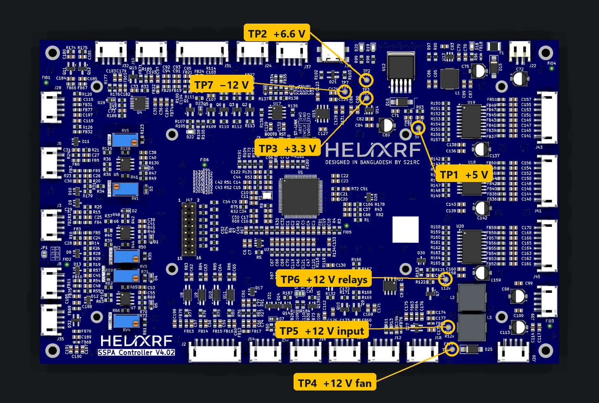

# Build and first power-up

How to wire the controller into your amplifier and check it before the PA
supply is ever switched on.

--8<-- "safety-rf.md"

## What you need

- A **12 V DC supply** for the controller (see [J22](connectors.md#j22-j23-12-v-power-in)).
- **JST PH (2.0 mm)** housings and crimp contacts, or wire for the solder pads.
- Shielded cable or twisted pairs for the SWR bridge signals.
- A **multimeter**.
- A **dummy load** rated for the full output power, and a **reference
  wattmeter** for the power calibration.
- A small screwdriver for the protection trimmers (RV1–RV5).

## Wiring

Wire the modules to the controller as shown in
[Connectors and wiring](connectors.md). It has the system diagrams, and a
pin-out and wiring sketch for every connector.

Suggested order:

1. 12 V supply ([J22](connectors.md#j22-j23-12-v-power-in)) and the display ([J18](connectors.md#j18-j19-display)).
2. High Side Switch: sense ([J8](connectors.md#j8-j9-psu-monitor)) and control ([J10](connectors.md#j10-j11-psu-protection)).
3. LPF module: power ([J39](connectors.md#j39-j40-lpf-module-power)) and band select ([J43 or J41](connectors.md#j41-j42-and-j43-j44-lpf-band-select)).
4. SWR bridges ([J3, J5](connectors.md#j3-j4-and-j5-j6-swr-bridges)), NTCs ([J28](connectors.md#j28-j29-ntc-temperature-sensors)) and fan ([J20](connectors.md#j20-j21-fan)).
5. PTT and RX/TX relay ([J26](connectors.md#j26-j27-ptt-and-rxtx-relay)), PA bias ([J30](connectors.md#j30-j31-pa-bias)).
6. Radio band data ([J1](connectors.md#j1-j2-band-data-and-rf-sense) or [J16](connectors.md#j16-j17-cat-ci-v)), ALC and TX inhibit ([J24](connectors.md#j24-j25-alc-and-tx-inhibit)), and the optional antenna selector ([J45](connectors.md#j45-j46-antenna-selector)) and rotator ([J32](connectors.md#j32-j33-rotator)).

[Connectors and wiring →](connectors.md){ .md-button }

## First power-up

Do this with the **PA supply switched off** and **no drive** from the radio.

1. Before connecting the board, measure the 12 V supply: check its polarity
   and that it reads 12–14 V.
2. Connect the 12 V supply and the display only. The power LED on the
   controller board lights, and the display shows the HelixRF splash screen,
   then the main screen.
   Measure the supply rails at the [test points](#test-points).
3. Swipe down to open the menu and tap **Info**. **Controller Firmware**
   shows a version number when the display and the controller are talking.
   If it stays at 0, check the display cable ([J18](connectors.md#j18-j19-display)):
   the controller's TX must go to the display's RX. See
   [Display and controller not talking](../troubleshooting.md#display-and-controller-not-talking).
4. Connect the rest of the wiring (power off while you plug in).
5. Power up again and open **Diagnose**. Check that both NTCs give a
   plausible reading and that nothing reads full scale (4095) with no signal
   applied. See [Diagnostics](../setup/index.md#diagnostics).
6. On the main screen, **press and hold PA ENABLE** until it turns bright
   green. (The PA supply is still off.)
7. Key the radio with its power at zero. **TRANSMIT** lights at the top
   right and you hear the RX/TX relay change over. Unkey: the relay drops.
   With PA ENABLE off the relay stays in receive: that is the standby mode.

!!! warning "Test the relay before connecting the drive"
    Check that the relay changes over on PTT with no RF applied, before you
    connect the drive cable.

## Test points

Seven test pads on the top of the controller board give quick access to
every supply rail. Measure them with a multimeter against GND (for example
J22 pin 1). The silkscreen label next to each pad is shown in brackets.

<figure markdown>
  [{ loading=lazy }](../assets/images/board-top-test-points.webp)
  <figcaption>Test points on the top of the controller board. Click to enlarge.</figcaption>
</figure>

| Test point | Rail | Expected | Supplies |
| --- | --- | --- | --- |
| **TP5** (R12v) | +12 V input, after fuse F1 | Your supply voltage | Everything below |
| **TP6** (L12v) | +12 V, filtered | Your supply voltage | LPF and antenna relay drivers, RX/TX relay |
| **TP4** (F12v) | +12 V fan, filtered | Your supply voltage | Fan connector J20 |
| **TP2** (6v6) | +6.6 V | 6.6 V | Buck converter output, feeds the 5 V regulator |
| **TP1** (5v) | +5 V | 5.0 V | Display, CAT, band-data and Neural supplies |
| **TP3** (3v3) | +3.3 V | 3.3 V | Processor, comparators, logic |
| **TP7** (12v) | −12 V | Negative, close to your supply voltage | ALC switch, pinch-off supply (J30 pin 6) |

If TP5 reads 0 V, check the supply polarity: the input fuse trips when the
supply is reversed. If TP5 is fine but a lower rail is missing, the stage
that makes it, or something loading it, is at fault. Disconnect the
connectors one at a time to find the load.

Then work through the setup in the order given in
[Getting started](../getting-started.md).

[Setup and calibration →](../setup/index.md){ .md-button .md-button--primary }
