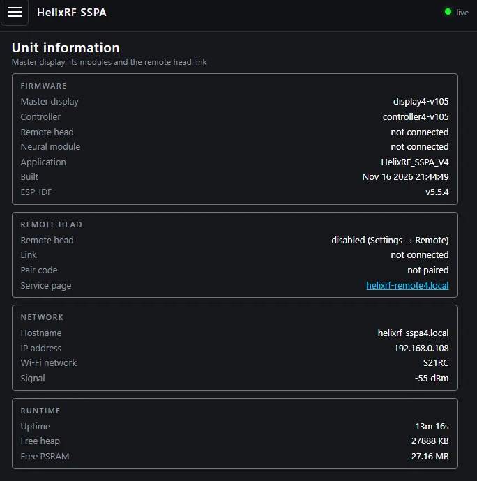
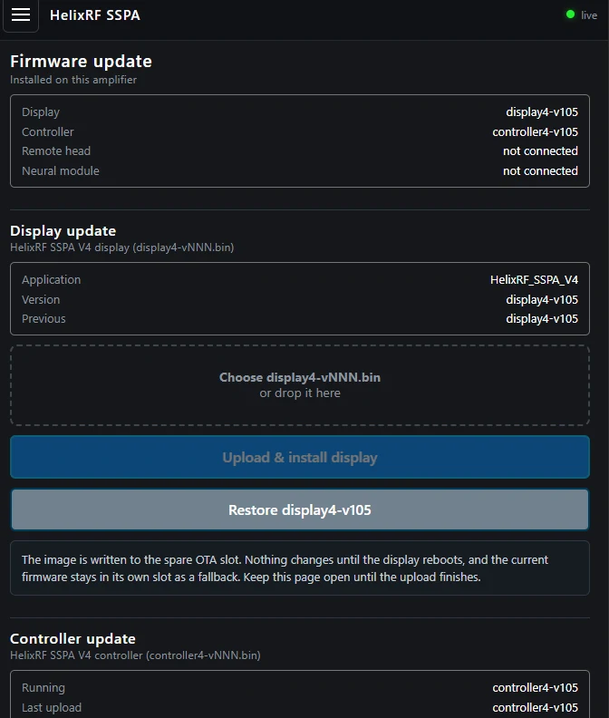

# Firmware and release notes

The controller board and the display each have their own firmware, and both
are updated from the browser app over WiFi. Updates are free. Download the
latest files from either:

- the **Downloads** section of helixrf.com, or
- the public firmware repository on GitHub:
  [github.com/s21rc/Helixrf-sspa-V4-public](https://github.com/s21rc/Helixrf-sspa-V4-public).

| Board | File | Example |
| --- | --- | --- |
| Display | `display4-vNNN.bin` | `display4-v105.bin` |
| Controller | `controller4-vNNN.bin` | `controller4-v105.bin` |
| Controller, USB recovery only | `controller4-vNNN_full.bin` | `controller4-v105_full.bin` |

Your settings are kept through updates.

## Check your versions

Menu → **Info** shows **Display Firmware**, **Controller Firmware**, and the
remote head and Neural module versions when they are connected.

The browser app shows the same, and more, under **Info**: the display
build, the remote head link and pair code, the network (hostname, IP
address, WiFi network and signal) and the uptime.

<figure markdown>
  { loading=lazy }
  <figcaption>Browser app → Info.</figcaption>
</figure>

## Updating

You need the display on WiFi with **Enable browser app** ticked (menu →
**Remote**). See [Network](../setup/network.md#wifi).

1. Stop transmitting. The update page refuses to start while the amplifier
   is keyed.
2. On a PC on the same network, open **http://helixrf-sspa4.local/**, open
   the menu (☰) and choose **Firmware Update**. The top of the page shows the
   installed versions.
3. Update the **display** first, then the **controller**.

<figure markdown>
  { loading=lazy }
  <figcaption>Browser app → Firmware Update.</figcaption>
</figure>

### Display

1. Under **Display update**, choose `display4-vNNN.bin` (or drop it on the
   box) and click **Upload & install display**.
2. Keep the page open until the upload finishes, then click **Reboot now**.

The new firmware is written to a spare slot; nothing changes until the
display restarts, and the previous firmware stays as a fallback. If the new
version misbehaves, the **Restore display4-vNNN** button (it names the
version it goes back to) switches back and restarts the display.

### Controller

1. Under **Controller update**, choose `controller4-vNNN.bin` (not the
   `_full.bin`) and click **Upload & flash controller**.
2. The amplifier stops for about 15 seconds while the controller is
   rewritten. The PA is held off and the display shows **FIRMWARE UPDATE ·
   DO NOT POWER OFF** with a progress bar.
3. The controller restarts and the display shows the new version.

If the update is interrupted (for example by a power cut), the controller
waits in its bootloader: open the page again and click **Retry flashing**.
**Restore controller4-vNNN** puts back the version that was installed
before.

## Recovering the controller (USB)

Needed only if a controller does not start and the browser update cannot
reach it. You need a PC with
[STM32CubeProgrammer](https://www.st.com/en/development-tools/stm32cubeprog.html)
and a USB-C cable.

1. Switch the 12 V supply on, with the PA supply off.
2. On the controller board, hold the **BOOT0** button, press and release
   **RST**, then release BOOT0. The controller is now in its USB
   bootloader. The two buttons sit side by side above the processor.
3. Connect the PC to the controller's USB-C port ([J34](../build/connectors.md#j34-usb-c)).
4. In STM32CubeProgrammer, choose **USB**, click **Connect**, open
   `controller4-vNNN_full.bin` and download it at address **0x08000000**.
5. Press **RST**. The controller starts with the new firmware, and later
   updates work from the browser again.

## Release notes

### Latest · firmware 105

Display and controller firmware 105.

- Hardware protection on antenna SWR, LPF SWR, output power, drain voltage,
  drain current and temperature, plus an external drive-overload input, with
  first-fault indication.
- RX/TX relay and bias sequencing, with re-arm after faults and power-up.
- SSB-safe peak-hold PEP and SWR, average power, and 3-point power
  calibration.
- Four meter faces: Power Bar, Needle Meter, Large Digit and Power Scope.
- Automatic band selection by band voltage, BCD, CAT (Yaesu) and CI-V (Icom),
  with editable per-radio tables, and LPF and antenna maps per band.
- Current sensing for shunt amplifiers, Hall sensors and BTS high-side
  switches.
- Fan control from two NTCs.
- Antenna rotator with 3-point calibration, 450° support and a GS-232B
  network server.
- Eltek Flatpack2 and Emerson eSure power supply control over CAN, with a
  low-voltage preset.
- Browser app, remote head and firmware updates for both boards over WiFi.
