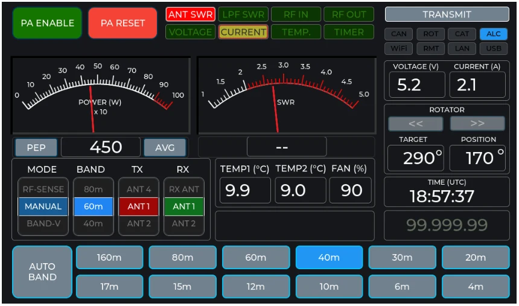
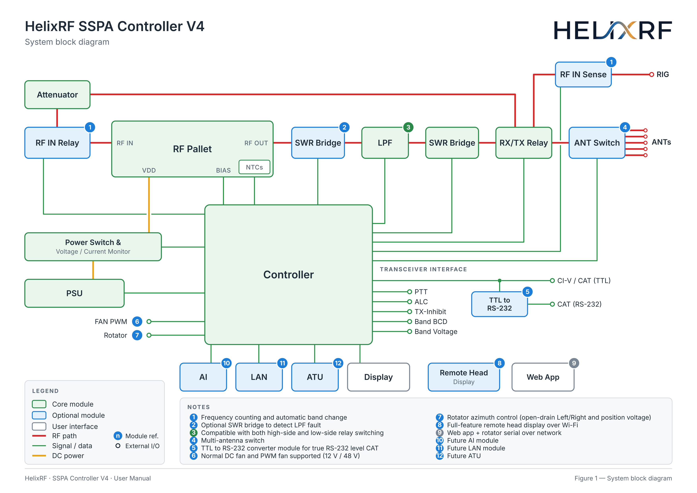

Manual · Helix SSPA Controller

# Helix SSPA Controller

Control and protection for solid-state HF amplifiers. The controller pairs an
STM32G474 control board with an ESP32-P4 touch display. It switches bands
automatically from your radio, sequences the RX/TX relay and the PA bias, and
trips in hardware on SWR, filter reflection, output power, temperature,
voltage and current.

This manual covers controller board **Rev 4.01** with firmware **105**
(controller and display). Use the version menu at the top to read an older
edition.

--8<-- "safety-rf.md"

<figure markdown>
  { loading=lazy }
  <figcaption>The main screen (needle meter face).</figcaption>
</figure>

## What it does

- **Protection in hardware.** Fast comparators trip on antenna SWR, LPF SWR,
  output power, PA temperature, supply voltage and drain current. A latch
  holds the fault, removes the bias, opens the PA supply switch, inhibits the
  radio and pulls its ALC down until you reset it.
- **Safe TX sequencing.** The RX/TX relay closes first, the bias follows 20 ms
  later, and on release the bias goes before the relay moves back. A PTT held
  at power-up or after a fault never keys the amplifier.
- **Automatic band switching** from band voltage, BCD, CAT or Icom CI-V, with
  per-band LPF and antenna maps.
- **Metering:** SSB-safe peak-hold PEP and SWR, average power, supply voltage
  and current, two temperatures and fan speed, on four meter faces.
- **Accessories:** 4-way antenna selector with a separate RX antenna, antenna
  rotator with GS-232B network control, and control of
  [compatible power supplies](setup/network.md#compatible-power-supplies)
  over CAN.
- **Remote:** a browser app on your phone or PC, and an optional second
  display (remote head) on your network. Firmware updates for both boards
  over WiFi.

## System overview

The controller sits at the centre of the amplifier: it switches the RF path,
biases the pallet, watches SWR, temperature, voltage and current, and talks to
the radio, the display and the optional modules. Numbered blocks are
explained in the notes on the diagram.

<figure markdown>
  [{ loading=lazy }](assets/wiring/system-block-diagram.png)
  <figcaption>System block diagram. Click to enlarge, or
  <a href="assets/wiring/helixrf-sspa-v4-block-diagram.pdf">download the PDF</a> for printing.</figcaption>
</figure>

[:material-file-pdf-box: Download the block diagram (PDF)](assets/wiring/helixrf-sspa-v4-block-diagram.pdf){ .md-button }

The High Side Switch, the high-voltage NMOS switch and the RF sense module
are separate HelixRF modules with their own manuals. This manual covers how
they connect to the controller.

-   :material-rocket-launch-outline: **[Getting started](getting-started.md)**

    The short path from a wired controller to a working amplifier.

-   :material-hammer-wrench: **[Build and first power-up](build/index.md)**

    Wiring order and the first power-up checks.

-   :material-gesture-tap: **[Using the controller](using/index.md)**

    The main screen, meter faces, gestures and quick actions.

-   :material-tune-variant: **[Setup and calibration](setup/index.md)**

    Current sensor, LPF map, temperature, protection trimmers and RF calibration.

-   :material-chip: **[Firmware and release notes](firmware/index.md)**

    Update both boards from your browser.

-   :material-headset: **[Free remote support](https://helixrf.com/remote-support/)**

    Stuck on setup or calibration? We connect to your station PC and help you get on the air.

[Buy the controller](https://helixrf.com/product/helixrf-sspa-controller/){ .md-button .md-button--primary }
[Request remote support](https://helixrf.com/remote-support/){ .md-button }
