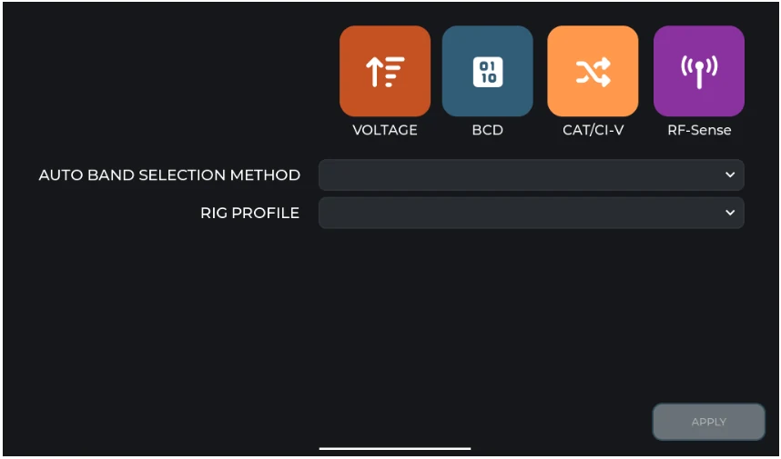
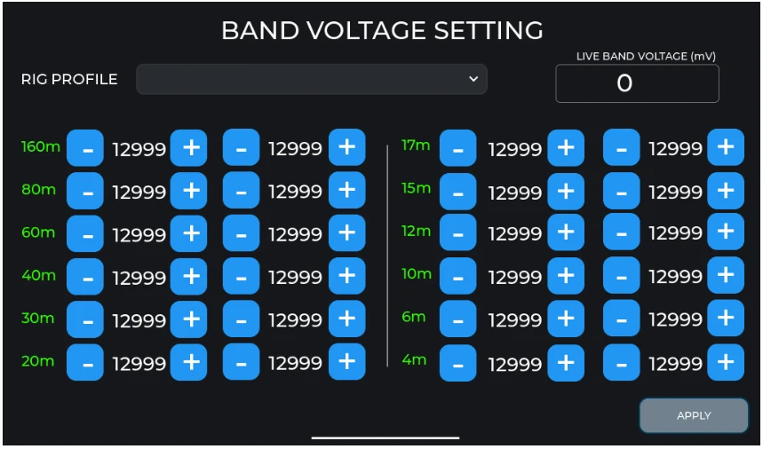
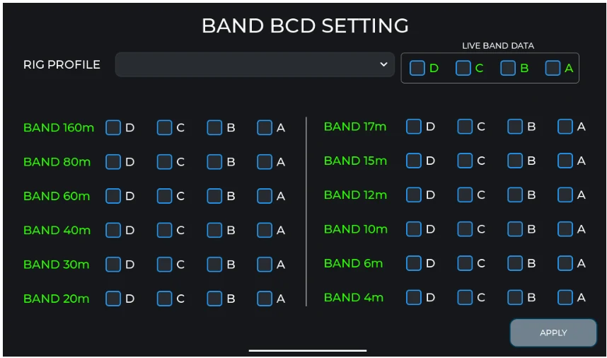
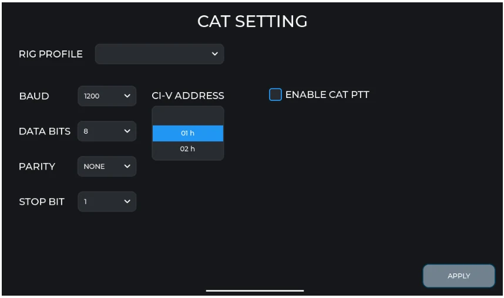
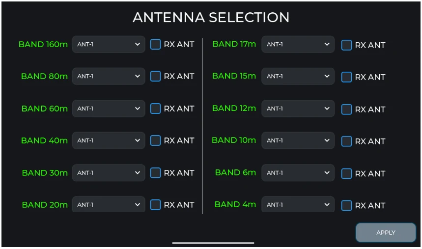

# Band data and radio

How the controller learns your radio's band, and which antenna each band
uses. With automatic band selection the LPF and the antenna follow the radio;
in manual you choose the band on the main screen.

## Choose the method and the radio

Menu → **Band Data**.

<figure markdown>
  { loading=lazy }
  <figcaption>Band Data.</figcaption>
</figure>

1. Choose the **AUTO BAND SELECTION METHOD**:

    | Method | Radio connection | Connector |
    | --- | --- | --- |
    | **None** | Manual band selection only | |
    | **Voltage** | Band-data voltage (Yaesu, Icom ACC) | [J1 pin 6](../build/connectors.md#j1-j2-band-data-and-rf-sense) |
    | **BCD** | 4-line BCD band data (Yaesu) | [J1 pins 2–5](../build/connectors.md#j1-j2-band-data-and-rf-sense) |
    | **CAT** | Serial CAT (Yaesu ASCII) | [J16](../build/connectors.md#j16-j17-cat-ci-v) |
    | **CI-V** | Icom CI-V | [J16 pin 3](../build/connectors.md#j16-j17-cat-ci-v) |
    | **RF-Sense** | HelixRF RF sense module; see its manual | [J1 pin 7](../build/connectors.md#j1-j2-band-data-and-rf-sense) |

2. Choose the **RIG PROFILE**: your radio, or **CUSTOM** for any other radio.
3. Tap **APPLY**.
4. Open the method's own page from the tiles at the top (**VOLTAGE**,
   **BCD**, **CAT/CI-V**) and check or enter the band table for your profile.
5. On the main screen, press and hold **AUTO BAND** so it lights. Change
   bands on the radio and check that the amplifier follows.

Built-in profiles:

| Profile | Methods | Notes |
| --- | --- | --- |
| **ICOM IC-7300** | Voltage, CI-V | CI-V address 94h, 19200 baud |
| **YAESU FTDX-10, FT-710** | Voltage, BCD, CAT | 38400 baud. BCD table preloaded (no code for 60 m and 4 m) |
| **CUSTOM** | All | Empty tables: enter your radio's values |

Each profile keeps its own band voltage table, BCD table and CAT settings, so
you can change radios by changing the profile. A method the profile does not
support is greyed out.

!!! warning "Check every band before you rely on it"
    A wrong table entry does not fail safe: it selects the wrong band, and
    with it the wrong LPF. Step through every band on the radio at low power
    and check that the amplifier shows the same band.

## Band voltage

Band Data → **VOLTAGE**. Each band has a voltage window: the band is
selected while the radio's band-data voltage lies between the two values.

<figure markdown>
  { loading=lazy }
  <figcaption>Band voltage setting.</figcaption>
</figure>

1. Choose the **RIG PROFILE**.
2. On the radio, select a band and read **LIVE BAND VOLTAGE (mV)**: the
   radio's real band-data voltage, already corrected for the on-board
   divider.
3. For that band, set the **left** value (low limit) a little below the
   reading and the **right** value (high limit) a little above it, with
   **−** / **+** (tap for 1 mV, hold for 10 mV). Leave a gap between
   neighbouring bands.
4. Repeat for every band. A band with both values at 0 is not used.
5. Tap **APPLY**.

## Band BCD

Band Data → **BCD**. Each band's BCD code on lines D, C, B and A.

<figure markdown>
  { loading=lazy }
  <figcaption>Band BCD setting.</figcaption>
</figure>

1. Choose the **RIG PROFILE**. The Yaesu profile comes with the standard
   Yaesu table.
2. On the radio, select a band. **LIVE BAND DATA** shows the code the radio
   sends.
3. Tick the same lines for that band. A band with no line ticked (0000) is
   not used.
4. Repeat for every band and tap **APPLY**.

The BCD inputs are optocoupled, so they accept the radio's band-data levels
without loading them.

## CAT and CI-V

Band Data → **CAT/CI-V**. The serial settings for the profile.

<figure markdown>
  { loading=lazy }
  <figcaption>CAT setting.</figcaption>
</figure>

| Setting | Enter |
| --- | --- |
| **RIG PROFILE** | The profile to edit |
| **BAUD** | 1200 to 250000. Must match the radio's CAT or CI-V baud rate. |
| **DATA BITS / PARITY / STOP BIT** | Usually 8, NONE, 1 |
| **CI-V ADDRESS** | The radio's CI-V address (Icom only), for example 94h for the IC-7300 |
| **ENABLE CAT PTT** | Leave off. The amplifier keys only from the wired PTT input. |

Tap **APPLY**. The **CAT** chip on the main screen lights when the radio
answers, and the frequency widget shows the radio's frequency.

On the radio:

- **Icom:** set **CI-V Transceive** to **ON**, and the CI-V baud rate to the
  same value as here (not Auto).
- **Yaesu:** set the CAT baud rate to the same value as here.

With CAT or CI-V, the link works both ways: tapping a band button on the
amplifier also changes the radio's band.

## Antenna selection

Menu → **Antenna**. The TX antenna for each band, and whether the band
receives on the dedicated RX antenna.

<figure markdown>
  { loading=lazy }
  <figcaption>Antenna selection.</figcaption>
</figure>

1. For each band, choose the TX antenna, **ANT-1** to **ANT-4**.
2. Tick **RX ANT** for bands where you receive on a separate antenna (for
   example a Beverage on 160 m and 80 m).
3. Tap **APPLY**.

The antenna never changes while transmitting. The RX antenna relay is on only
while receiving with PA ENABLE on, and drops the instant the amplifier keys,
to protect the receiver. With PA ENABLE off, the radio receives on the TX
antenna. See [J45](../build/connectors.md#j45-j46-antenna-selector) for the
relay wiring.
