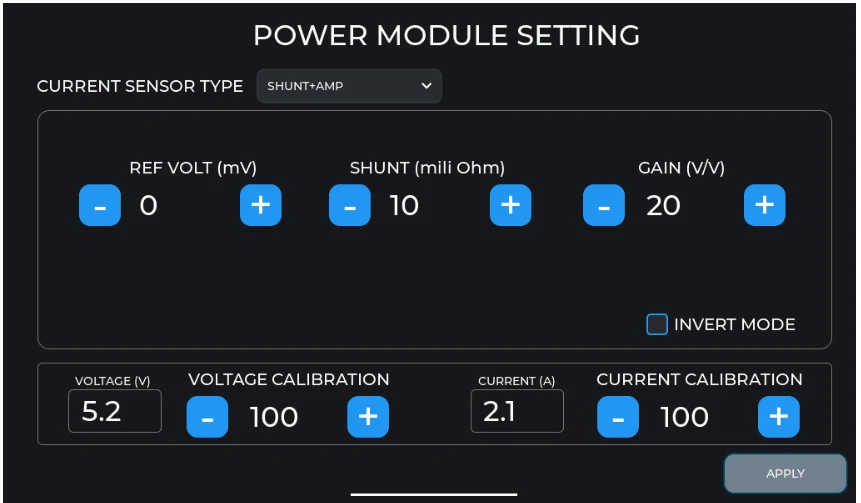
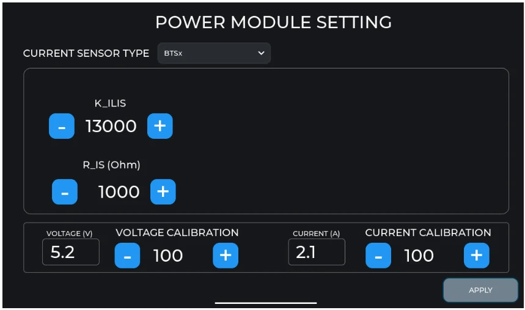
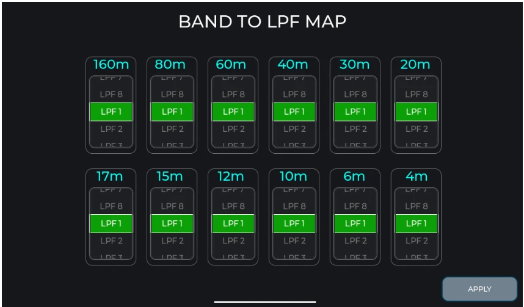
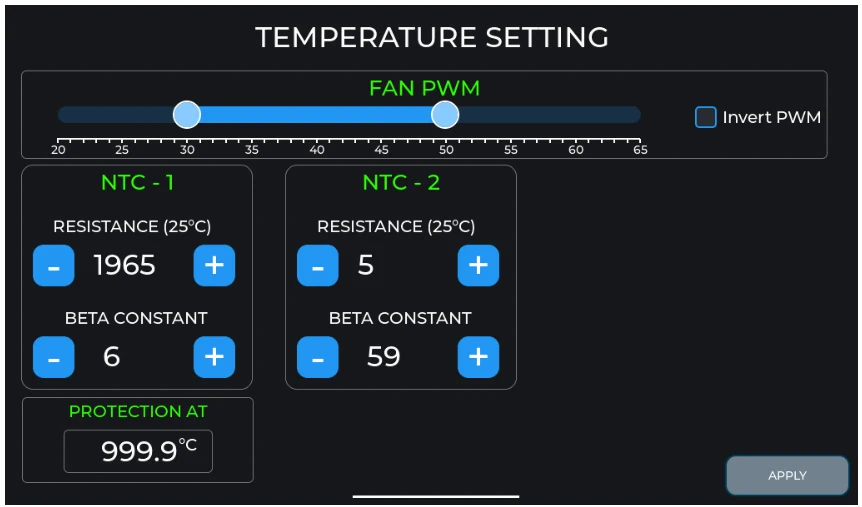
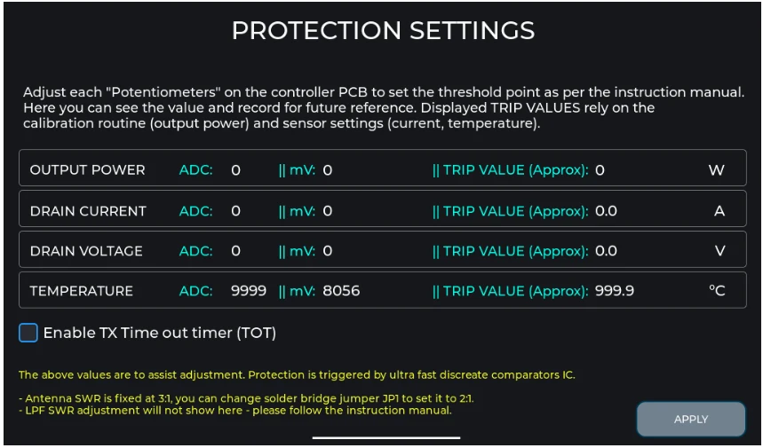
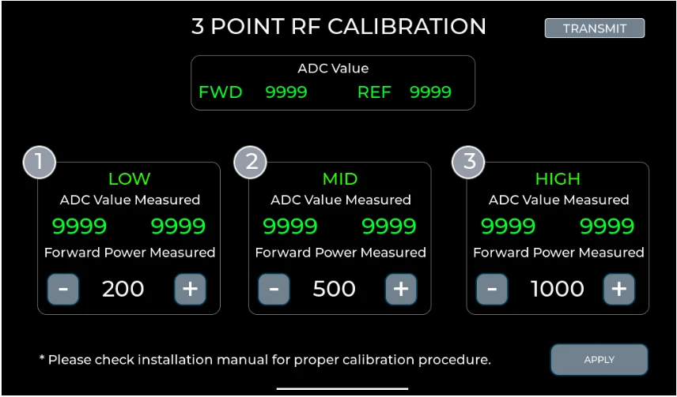
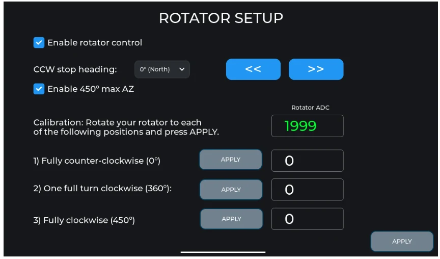
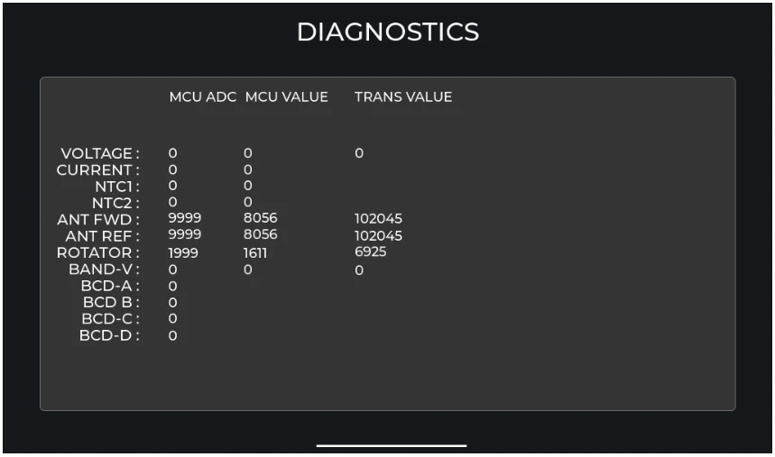

# Setup and calibration

Configure the controller for your amplifier, in the order below. Every page
is opened from the menu (swipe down on the main screen) and saved with
**APPLY**. **Configuration Saved** confirms that the controller has stored
the settings.

--8<-- "safety-rf.md"

## Power module (current sensor)

Menu → **Power**. Tells the controller how to read the PA current from your
High Side Switch or power module, and trims the voltage and current readings.

Three sensor types are supported. Choose the one your module uses in
**CURRENT SENSOR TYPE**, and take its values from the module's manual or the
sensor's datasheet. The fields on the page change with the type.

=== "SHUNT+AMP"

    { loading=lazy }

    A shunt resistor with a current-sense amplifier (for example INA240).

    | Setting | Enter |
    | --- | --- |
    | **REF VOLT (mV)** | The amplifier's output at zero current. 0 for a unidirectional amplifier. |
    | **SHUNT (mili Ohm)** | The shunt resistance **in tenths of a milliohm**: 10 = 1.0 mΩ. |
    | **GAIN (V/V)** | The amplifier's gain, for example 20 for an INA240A1. |
    | **INVERT MODE** | Tick if the current reads negative. |

    Example: an INA240A1 (gain 20) with a 1 mΩ shunt is REF VOLT 0,
    SHUNT 10, GAIN 20.

=== "HALL EFFECT"

    A Hall-effect current sensor.

    | Setting | Enter |
    | --- | --- |
    | **REF VOLT (mV)** | The sensor's output at zero current, from its datasheet (often half its supply). |
    | **HALL SENSITIVITY (mV/A)** | The sensitivity **in tenths of a mV/A**: 400 = 40.0 mV/A. |
    | **INVERT MODE** | Tick if the current reads negative. |

=== "BTSx"

    { loading=lazy }

    A PROFET high-side switch with a current-sense output (BTS50085 class).

    | Setting | Enter |
    | --- | --- |
    | **K_ILIS** | The current-sense ratio from the datasheet, for example 13000. |
    | **R_IS (Ohm)** | The sense resistor fitted on the module. 0 if none is fitted (the controller's own 10.1 kΩ load is then used). |

**Calibration** (all sensor types): with the PA supply on, compare
**VOLTAGE (V)** and **CURRENT (A)** with a multimeter. Adjust **VOLTAGE
CALIBRATION** and **CURRENT CALIBRATION** (percent, 50–150, 100 = no
correction) until they match. The readings update as you press the buttons.
Tap **APPLY**.

## LPF map

Menu → **LPF Map**. Chooses which of the eight LPF banks (BAND1–BAND8
outputs) each band uses.

<figure markdown>
  { loading=lazy }
  <figcaption>Band to LPF map.</figcaption>
</figure>

1. Scroll each band's roller to its LPF bank (LPF 1 = BAND1 output, and so
   on). Bands that share a filter use the same bank.
2. Tap **APPLY**.
3. Check it: tap each band button on the main screen and confirm that the
   right filter relay clicks.

!!! danger "A wrong LPF map can destroy the PA"
    Transmitting through a filter for a lower band puts the full output into
    a filter that reflects it. The LPF SWR trip catches this, but check the
    map at low power before you run full power on any band.

## Temperature and fan

Menu → **Temperature**.

<figure markdown>
  { loading=lazy }
  <figcaption>Temperature setting.</figcaption>
</figure>

| Setting | What it does |
| --- | --- |
| **FAN PWM** slider | Left handle: the temperature where the fan starts to speed up (it runs at 10 % below it). Right handle: the temperature for full speed. Range 20–65 °C. |
| **Invert PWM** | Tick if the fan runs fast when cold. |
| **RESISTANCE (25 °C)** | Each NTC's resistance at 25 °C, in ohms (10000 for a 10 kΩ NTC). |
| **BETA CONSTANT** | Each NTC's beta value (3950 for the common 10 kΩ type). |
| **PROTECTION AT** | The hardware over-temperature trip point, set by RV5 (read only here). See [Protection](#protection). |

The fan follows whichever NTC is hotter. Tap **APPLY**, then check both
temperatures on the main screen against a thermometer.

## Protection

Menu → **Protection**. The trip levels are set with trimmers on the
controller board, not in software: the protection works even if the
processor stops. This page shows each trimmer's setting as an approximate
trip value, so you can set it and record it.

<figure markdown>
  { loading=lazy }
  <figcaption>Protection settings.</figcaption>
</figure>

| Trimmer | Sets | Shown on this page as |
| --- | --- | --- |
| **RV1** | LPF SWR trip | Not shown (see below) |
| **RV2** | Output power trip (RF OUT) | OUTPUT POWER, W |
| **RV3** | Supply voltage trip | DRAIN VOLTAGE, V |
| **RV4** | Drain current trip | DRAIN CURRENT, A |
| **RV5** | Temperature trip (NTC 1) | TEMPERATURE, °C |

The antenna SWR trip is fixed at **3:1**. Bridge solder jumper **JP1** to
make it **2:1**.

The trip values shown depend on the settings before them: the power trip on
the [RF power calibration](#rf-power-calibration), the current trip on the
[current sensor](#power-module-current-sensor), the temperature trip on the
[NTC values](#temperature-and-fan). Set those first. Set RV2 after the RF
calibration.

1. Turn each trimmer until its **TRIP VALUE** reads the level you want. Set
   the trips a safe margin above normal operation and below the pallet's
   ratings:
    - **Drain voltage:** a few volts above your PA supply voltage.
    - **Drain current:** above the highest current at full power, below the
      pallet's maximum.
    - **Temperature:** below the pallet's maximum heatsink temperature.
    - **Output power:** above your full output power, below the pallet's and
      the LPF's rating.
2. Write the values down for future reference.
3. Tap **APPLY**.

**LPF SWR (RV1).** RV1 sets how much reflection between the PA and the LPF
trips the amplifier. Its setting is not shown on the display. More
resistance on RV1 makes the trip less sensitive. Set it so that:

- with the **correct** filter, the amplifier never trips at full power into a
  dummy load, and
- with a **wrong** filter (map the band to a lower band's bank for the test),
  it trips at low power.

!!! info
    The trip values on this page are approximate. Comparator offset and the
    hysteresis resistors shift the real trip point a little. Confirm each
    trip with the [test](#test-the-protection) below.

**Enable TX Time out timer (TOT)** is reserved for a later firmware and has
no effect in firmware 105.

## RF power calibration

Menu → **RF Calibrate**. Calibrates the power meter (and the output power
trip) at three power levels, against a reference wattmeter.

<figure markdown>
  { loading=lazy }
  <figcaption>3-point RF calibration.</figcaption>
</figure>

You need a dummy load rated for full power and a reference wattmeter
between the amplifier and the load. Use a steady carrier (CW key down, FM or
RTTY), on the band you use most.

1. Set the radio to a low drive. Key the amplifier and read the wattmeter:
   about 20 % of full power.
2. While transmitting, set **LOW · Forward Power Measured** to the
   wattmeter reading with **−** / **+** (tap for 1 W, hold for 10 W), then
   tap the **1** to capture the ADC values. They appear under **ADC Value
   Measured**.
3. Unkey. Repeat at about 50 % power for **MID** (tap **2**) and at full
   power for **HIGH** (tap **3**).
4. Tap **APPLY**.

The three points must increase from LOW to HIGH. The live **ADC Value** at
the top shows the forward and reflected readings while you transmit.
Uncalibrated, the power meter reads 0.

## Rotator

Menu → **Rotator**.

<figure markdown>
  { loading=lazy }
  <figcaption>Rotator setup.</figcaption>
</figure>

1. Tick **Enable rotator control**.
2. Set **CCW stop heading**: the compass direction the antenna points to at
   the counter-clockwise end stop (North, East, South or West).
3. Tick **Enable 450° max AZ** if your rotator turns 450°.
4. Hold **<<** until the rotator reaches its counter-clockwise end stop.
   Tap **APPLY** on line **1)**.
5. Hold **>>** for one full turn clockwise (360°). Tap **APPLY** on line
   **2)**.
6. For a 450° rotator, hold **>>** to the clockwise end stop. Tap **APPLY**
   on line **3)**.
7. Tap **APPLY** at the bottom to save.

On this page the << >> buttons ignore the soft limits, so you can reach the
end stops. **Rotator ADC** shows the live position reading; it must change
smoothly as the rotator turns. If **>>** turns counter-clockwise, swap the
relay wires (see [J32](../build/connectors.md#j32-j33-rotator)).

On the main screen, hold **<<** or **>>** to turn; the rotator stops when you
release. For control from a PC program, see
[Rotator over the network](network.md#rotator-over-the-network).

## Diagnostics

Menu → **Diagnose**. Live readings of every analog input, for fault finding.

<figure markdown>
  { loading=lazy }
  <figcaption>Diagnostics.</figcaption>
</figure>

| Column | Meaning |
| --- | --- |
| **MCU ADC** | Raw reading, 0–4095 |
| **MCU VALUE** | Voltage at the processor pin, in mV |
| **TRANS VALUE** | Translated back to the connector, for example the radio's real band voltage before the on-board divider |

A reading stuck at 0 usually means an open connection; 4095 with nothing
applied means a short to a supply or a wrong wiring. **BCD-A** to **BCD-D**
show the four BCD inputs as 0 or 1.

## Test the protection

Test every trip into a dummy load before going on the air, and again after
any change to the wiring or the trimmers. Each time, check that the
indicator lights, **PA RESET** turns red, the relay drops and the bias goes
off. Then reset with PA RESET.

| Trip | How to test |
| --- | --- |
| **ANT SWR** | At low power, transmit into a load above 3:1 (for example 200 Ω, 4:1). |
| **LPF SWR** | At low power, map the band to a lower band's LPF bank and transmit. Restore the LPF map afterwards. |
| **RF OUT** | Turn RV2 down to a low trip (for example 100 W) and transmit above it. Set RV2 back. |
| **VOLTAGE** | With the PA supply on, turn RV3 down until it trips. Set RV3 back. |
| **CURRENT** | Turn RV4 down to a low trip and transmit. Set RV4 back. |
| **TEMP.** | Turn RV5 down to just below the heatsink temperature. Set RV5 back. |

After setting a trimmer back, check its value on the Protection page against
the value you wrote down.
