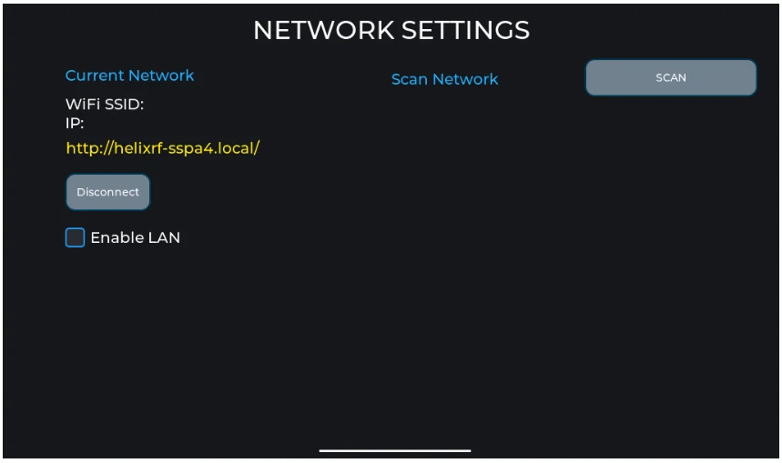
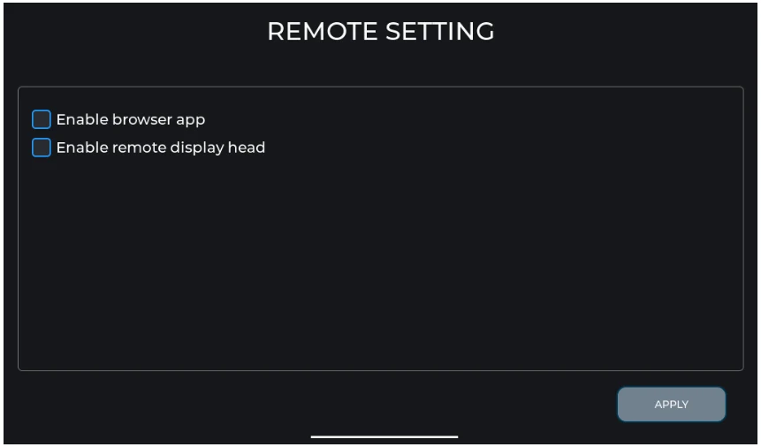
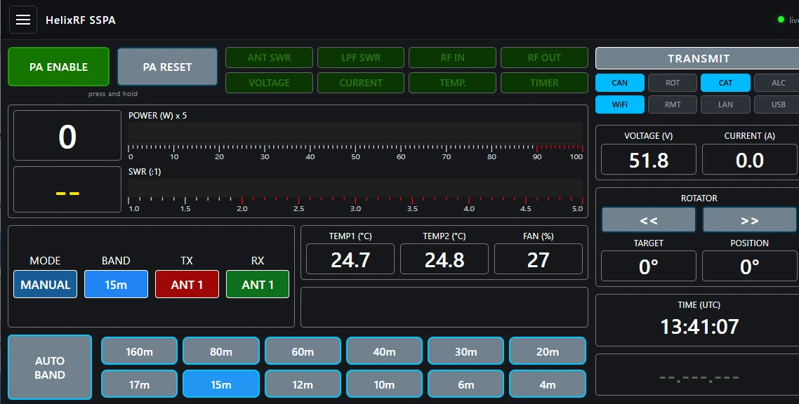
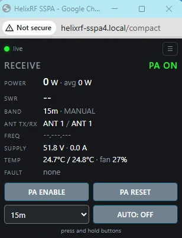
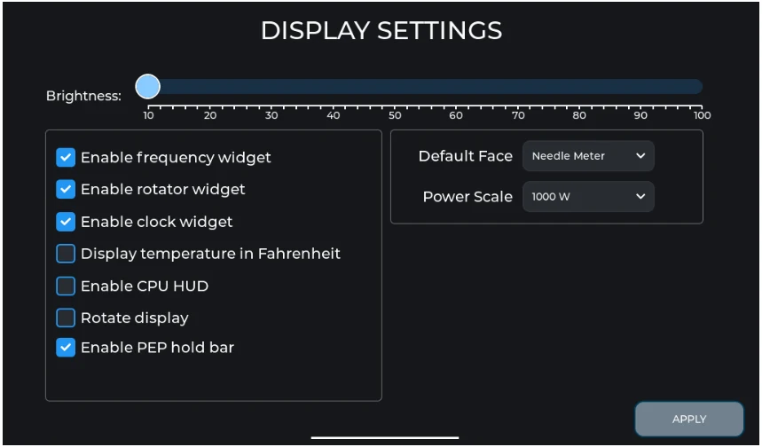
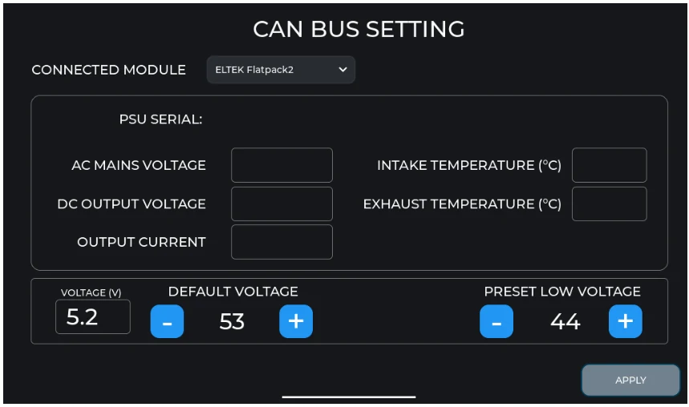

# Network, display and power supply

WiFi, the browser app, the remote head, network rotator control, the display
settings and the CAN power supply. None of these is needed to operate the
amplifier, but WiFi is needed for firmware updates.

## WiFi

Menu → **Network**.

<figure markdown>
  { loading=lazy }
  <figcaption>Network settings.</figcaption>
</figure>

1. Tap **SCAN**. The networks in range appear on the right.
2. Tap your network, type the password and tap **Connect**.
3. **WiFi SSID** and **IP** show the connection, and the **WiFi** chip on the
   main screen lights.

The display remembers the network and reconnects at power-up. **Disconnect**
drops it. On your network the amplifier is reachable as
**http://helixrf-sspa4.local/** (or by the IP address shown).

**Enable LAN** is reserved and has no effect in firmware 105. To switch WiFi
off quickly, use **AIRPLANE MODE** in [Quick Action](../using/index.md#quick-action).

## Remote

Menu → **Remote**.

<figure markdown>
  { loading=lazy }
  <figcaption>Remote setting.</figcaption>
</figure>

| Setting | What it does |
| --- | --- |
| **Enable browser app** | Runs the browser app on your network (needs WiFi). |
| **Enable remote display head** | Lets a HelixRF remote head connect. **PAIR** appears to approve one. |

The choices are saved as soon as you tick them.

### Browser app

Open **http://helixrf-sspa4.local/** on a phone, tablet or PC on the same
network. The dot at the top right shows **live** while the page is connected
to the amplifier. The menu (☰) has four pages.

**Main**: a live copy of the main screen: meters, fault indicators, status
chips, temperatures, voltage and current, band buttons, AUTO BAND, rotator,
and **PA ENABLE** and **PA RESET** (press and hold, as on the display).

<figure markdown>
  { loading=lazy }
  <figcaption>Browser app, main page.</figcaption>
</figure>

**Compact View**: the same live state in a small panel, without the meters,
to keep next to your logging program. **Pop out** opens it in its own small
window. It shows receive or transmit, PA on or off, power, SWR, band and
method, antennas, frequency, supply, temperatures and the active fault, with
PA ENABLE, PA RESET, a band list and AUTO.

<figure markdown>
  { loading=lazy }
  <figcaption>Compact View, popped out.</figcaption>
</figure>

**Firmware Update**: see [Firmware](../firmware/index.md#updating).

**Info**: firmware versions, remote head link, network and uptime; see
[Check your versions](../firmware/index.md#check-your-versions).

Every tap goes to the controller through the same path as the touch screen,
and the controller applies its usual checks: no band change while
transmitting, no reset while a fault is present. Transmit is never possible
from the browser: PTT stays on the wired input.

!!! note
    The browser app has no password. Use it only on your own network, and do
    not forward it to the internet.

### Remote head

A remote head is a second HelixRF display that mirrors the amplifier over
your network, for example on the operating desk while the amplifier sits in
another room. It shows and controls everything the main display does.

1. On the amplifier, tick **Enable remote display head**.
2. Connect the remote head to the same WiFi. It shows a four-digit pair code
   on its own Remote page.
3. On the amplifier, tap **PAIR**. A window shows the code of the head that
   is waiting. If it matches the code on the head in front of you, confirm.

The amplifier remembers the head, so later connections need no approval. The
**RMT** chip lights while the head is connected. To replace the head, tap
**PAIR** with no head waiting and forget the stored one. The remote head's
own service page is at **http://helixrf-remote4.local/**.

### Rotator over the network

While the rotator is enabled, the amplifier runs a Yaesu **GS-232B** server
on **TCP port 4001**, compatible with the K3NG rotator controller. Set your
rotator program (for example PSTRotator or a logging program) to GS-232B
over TCP/IP, host **helixrf-sspa4.local**, port **4001**. The **ROT** chip
lights while a program is connected. One program at a time can connect.

## Display

Menu → **Display**. These settings are stored in the display.

<figure markdown>
  { loading=lazy }
  <figcaption>Display settings.</figcaption>
</figure>

| Setting | What it does |
| --- | --- |
| **Brightness** | Backlight, 10–100 %. Changes as you slide. |
| **Enable frequency widget** | Shows the radio frequency (CAT or CI-V) on the main screen. |
| **Enable rotator widget** | Shows the rotator panel on the main screen. |
| **Enable clock widget** | Shows the UTC clock. |
| **Display temperature in Fahrenheit** | °F instead of °C. |
| **Enable CPU HUD** | A small performance overlay, for service. |
| **Rotate display** | Turns the picture 180°, for a display mounted upside down. Takes effect after a restart. |
| **Enable PEP hold bar** | A ghost bar showing the recent peak on the Power Bar face. |
| **Default Face** | The meter face shown at power-up: Power Bar, Needle Meter, Large Digit or Power Scope. |
| **Power Scale** | Full scale of the power meters: 500, 1000, 1500 or 2000 W. |

Tap **APPLY** to keep the settings.

## CAN bus (power supply)

Menu → **CAN Bus**. Monitors and sets the voltage of a server power supply
on the display's CAN bus.

<figure markdown>
  { loading=lazy }
  <figcaption>CAN bus setting.</figcaption>
</figure>

### Compatible power supplies

| Power supply | Output range set from the display | Notes |
| --- | --- | --- |
| **Eltek Flatpack2** (48 V HE) | 44–57 V | Telemetry, default voltage, low-voltage preset |
| **Emerson / Vertiv eSure** (R48) | 42–58 V | Telemetry, default voltage (applies at the next power-up) |

More supplies will be added in later firmware.

### Wiring

Wire the display's CAN port to the supply's CAN bus (CAN-H to CAN-H, CAN-L
to CAN-L, 125 kbit/s), with a twisted pair.

!!! note "Termination"
    A CAN bus needs a 120 Ω resistor at each end. The SSPA end is already
    terminated with 120 Ω. At the power supply end, check whether the supply
    or its shelf terminates the bus. If not, fit a **120 Ω, 1/4 W** resistor
    between CAN-H and CAN-L at the supply's connector.

### Setup

1. Choose the **CONNECTED MODULE**: **ELTEK Flatpack2** or **Emerson eSure**.
   The **CAN** chip on the main screen lights when the bus is live.
2. The page shows the supply's serial number, AC mains voltage, DC output
   voltage and current, and its temperatures.
3. Set **DEFAULT VOLTAGE**: the output voltage at power-up (Flatpack2:
   44–57 V).
4. Set **PRESET LOW VOLTAGE**: the voltage that **PRESET LOW VOLT** in Quick
   Action switches to (44–48 V, never above the default).
5. Tap **APPLY**.

**Flatpack2:** after APPLY the supply stores the new default. Its telemetry
drops out for about 20 seconds, then the output moves to the new voltage.

**eSure:** the new default is stored in the supply and takes effect when the
supply is next powered up.

!!! warning
    Set the default voltage within your pallet's rating. The amplifier's
    over-voltage trip (RV3) is your backstop; see
    [Protection](index.md#protection).
