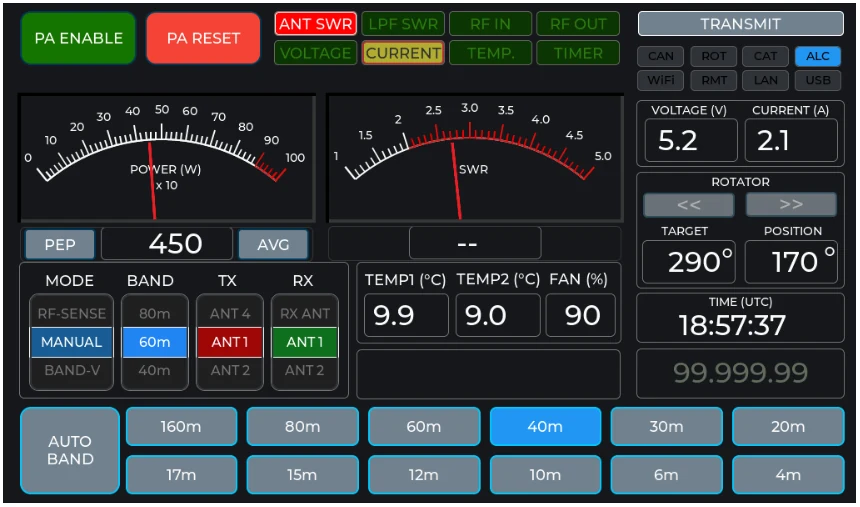
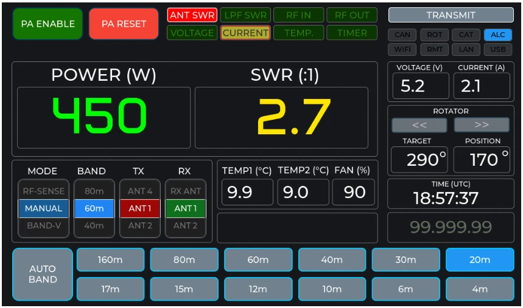
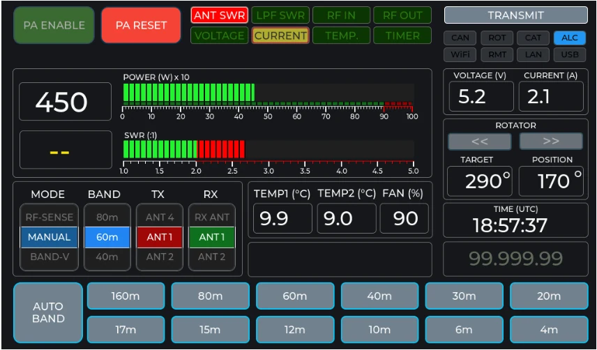
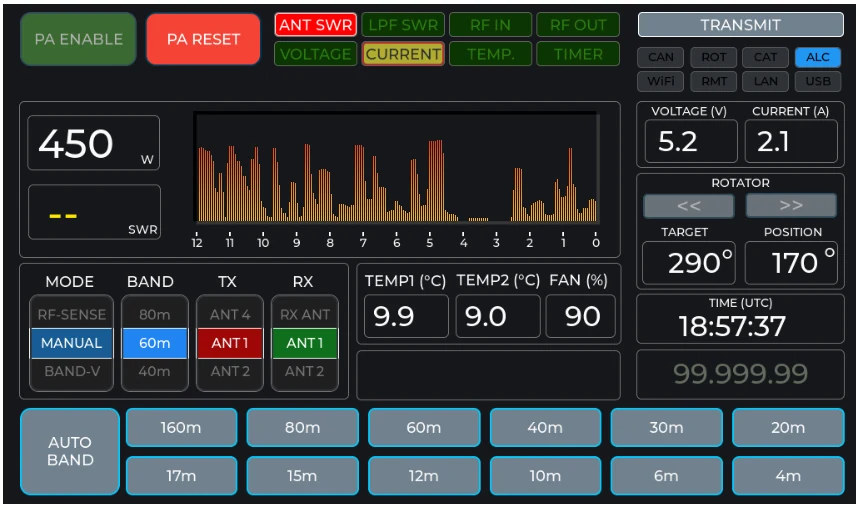
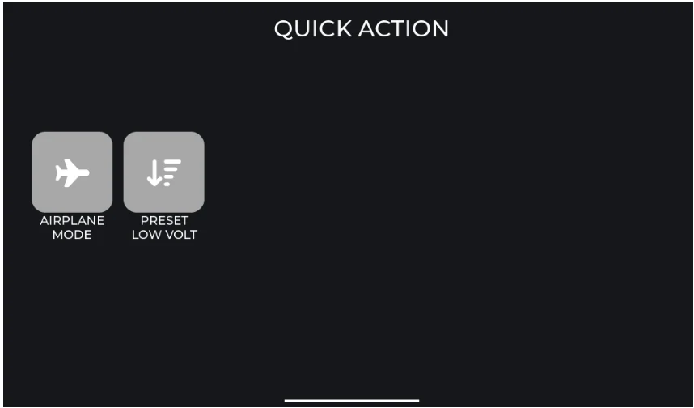
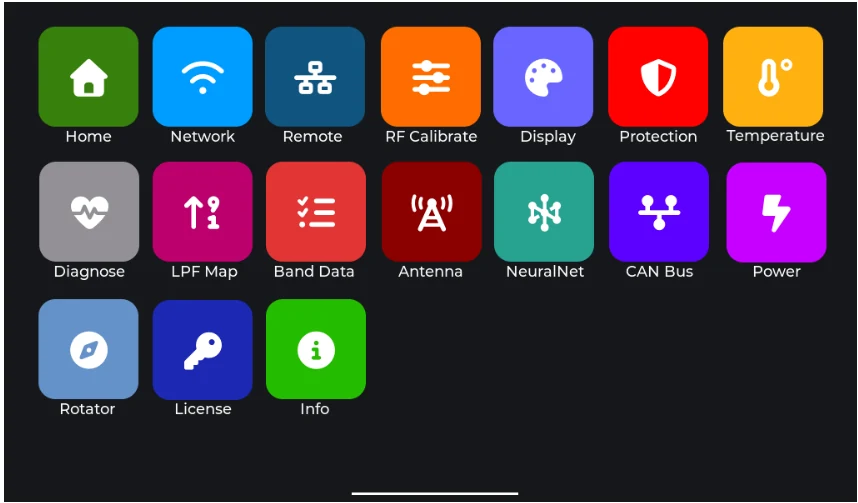

# Using the controller

The main screen, the meter faces, the gestures and what happens when the
protection trips.

## Gestures

| Gesture | On the main screen | On the menu or a settings page |
| --- | --- | --- |
| Swipe **down** | Opens the menu | |
| Swipe **up** | Opens Quick Action | Goes back |
| Swipe **left / right** | Next / previous meter face | |
| **Press and hold** | PA ENABLE, PA RESET, AUTO BAND | +/- buttons repeat in steps of 10 |

## The main screen

<figure markdown>
  { loading=lazy }
  <figcaption>Main screen with the needle meter face.</figcaption>
</figure>

### Top row

| Control | What it does |
| --- | --- |
| **PA ENABLE** | Press and hold to switch the amplifier between operate (bright green) and standby (dark). In standby the RX/TX relay stays in receive and the radio goes straight through. Refused while transmitting. The setting is remembered across power cycles. |
| **PA RESET** | Lights red while the protection is latched. Press and hold to clear the latch and reset external modules. Refused while any fault is still present or while transmitting. See [When the protection trips](#when-the-protection-trips). |
| **Fault indicators** | One per protection input. See the table below. |
| **TRANSMIT** | Lit while the amplifier is keyed. |

| Fault indicator | Trips when |
| --- | --- |
| **ANT SWR** | SWR at the antenna bridge exceeds 3:1 (2:1 with JP1 bridged) |
| **LPF SWR** | Reflection between the PA and the LPF is too high: wrong or failed filter |
| **RF IN** | The external drive-overload input ([J14 pin 4](../build/connectors.md#expansion-and-service-connectors)) is active |
| **RF OUT** | Output power exceeds the RV2 setting |
| **VOLTAGE** | PA supply voltage exceeds the RV3 setting |
| **CURRENT** | Drain current exceeds the RV4 setting |
| **TEMP.** | NTC 1 temperature exceeds the RV5 setting |
| **TIMER** | Reserved for the TX time-out timer |

An indicator is **red** while its fault is present. It turns **amber** when
the fault has cleared but was the cause of a trip that is still latched, so
you can see what tripped after the event.

### Status chips

The small chips at the top right show what is connected.

| Chip | Lit when |
| --- | --- |
| **CAN** | Traffic on the display's CAN bus (power supply connected) |
| **ROT** | A rotator program is connected over the network (GS-232B) |
| **CAT** | The radio is answering on CAT or CI-V |
| **ALC** | The protection is latched: ALC pulled down and TX inhibit on |
| **WiFi** | The display is connected to your WiFi |
| **RMT** | A remote head is connected |
| **LAN** | Reserved |
| **USB** | A computer is connected to the display's USB port |

### Meters and readouts

- **Power and SWR.** Power is shown as PEP (peak hold) or average; SWR is
  computed from held envelope peaks, so it stays steady on SSB voice. SWR
  shows `--` while receiving. The full scale follows **Power Scale** in
  [Display settings](../setup/network.md#display).
- **VOLTAGE / CURRENT.** PA supply voltage and drain current from the High
  Side Switch.
- **TEMP1 / TEMP2 / FAN.** Both NTC temperatures and the fan speed in percent.
- **ROTATOR.** Target and current heading, with **<<** and **>>** to turn the
  rotator while you hold the button. Shown when the rotator widget is on.
- **TIME (UTC).** Set from the internet when the display is on WiFi.
- **Frequency.** The radio's frequency, when CAT or CI-V is in use.

### Band and antenna

The **MODE / BAND / TX / RX** panel shows the band selection method (MANUAL,
BAND-V, BCD, CAT or CI-V), the active band, the TX antenna and the RX
antenna (**RX ANT** when the dedicated receive antenna is in use).

The **band buttons** at the bottom select a band by hand. The button lights
once the controller has switched the LPF and antenna, not before.

**AUTO BAND**: press and hold to switch between automatic band selection
(from your radio) and manual. Not available while transmitting. In manual,
the band buttons choose the band; in auto, the radio does. With CAT or CI-V,
choosing a band on the amplifier also changes the radio's band.

!!! note
    The band never changes while transmitting. A band you tap during TX is
    ignored; a band change reported by the radio during TX is applied the
    moment you unkey.

## Meter faces

Swipe left or right to change the face. Choose the face shown at power-up in
[Display settings](../setup/network.md#display).

=== "Needle Meter"

    { loading=lazy }

    Analog power and SWR meters. **PEP** and **AVG** choose what the power
    needle shows.

=== "Large Digit"

    { loading=lazy }

    Power and SWR in large digits, readable across the room.

=== "Power Bar"

    { loading=lazy }

    Bar graphs for power and SWR. With **PEP hold bar** on, a ghost bar
    marks the recent peak.

=== "Power Scope"

    { loading=lazy }

    A scrolling waveform of the forward power over the last 12 seconds
    (newest on the right), for checking your keying and speech envelope.
    The bars run from yellow at the foot to red at the top of the scale,
    which follows **Power Scale**.

More faces will be added in later firmware updates.

## Quick Action

Swipe up on the main screen.

<figure markdown>
  { loading=lazy }
  <figcaption>Quick Action.</figcaption>
</figure>

| Button | What it does |
| --- | --- |
| **AIRPLANE MODE** | Switches the display's WiFi off, and back on. The browser app, remote head and network rotator control stop while it is on. An aeroplane icon shows on the main screen. |
| **PRESET LOW VOLT** | Drops the power supply to its low-voltage preset (for example for low-power operation or tuning), and back to its default. Needs a [compatible power supply](../setup/network.md#compatible-power-supplies) on the CAN bus. The PA supply returns to its default after a power cycle. |

## The menu

Swipe down on the main screen. Tap a tile to open the page; swipe up to come
back.

<figure markdown>
  { loading=lazy }
  <figcaption>The menu.</figcaption>
</figure>

| Tile | Page |
| --- | --- |
| Home | Back to the main screen |
| Network | [WiFi](../setup/network.md#wifi) |
| Remote | [Browser app and remote head](../setup/network.md#remote) |
| RF Calibrate | [RF power calibration](../setup/index.md#rf-power-calibration) |
| Display | [Display settings](../setup/network.md#display) |
| Protection | [Protection trip levels](../setup/index.md#protection) |
| Temperature | [NTCs and fan](../setup/index.md#temperature-and-fan) |
| Diagnose | [Live readings](../setup/index.md#diagnostics) |
| LPF Map | [Band to LPF bank](../setup/index.md#lpf-map) |
| Band Data | [Band selection method and radio](../setup/band-data.md) |
| Antenna | [Antenna per band](../setup/band-data.md#antenna-selection) |
| NeuralNet | Settings for the HelixRF Neural module |
| CAN Bus | [Power supply over CAN](../setup/network.md#can-bus-power-supply) |
| Power | [Current sensor](../setup/index.md#power-module-current-sensor) |
| Rotator | [Rotator setup](../setup/index.md#rotator) |
| License | Licence activation |
| Info | [Firmware versions](../firmware/index.md#check-your-versions) |

## When the protection trips

The comparators trip in nanoseconds and set a hardware latch. The latch,
without waiting for the processor:

- removes the PA bias and pulls the optional gate-kill line to GND,
- switches the PSU protection lines, so the High Side Switch turns the PA
  supply off,
- pulls the radio's ALC down and asserts TX inhibit.

The controller then drops the RX/TX relay and switches PA ENABLE off. The
fault indicators show which input tripped.

To recover:

1. Unkey the radio.
2. Find and fix the cause: check the antenna, the band and LPF, the drive
   level and the temperatures.
3. Wait until no indicator is red (amber is fine).
4. Press and hold **PA RESET**. The latch clears, and PA ENABLE returns to
   what it was before the trip.

If PA RESET does nothing, a fault is still present: its indicator is red.
After a reset you have to unkey once before the amplifier keys again, so a
PTT that was held through the fault never closes the relay into live drive.
