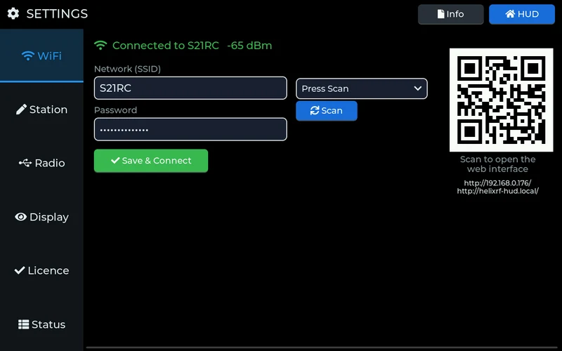
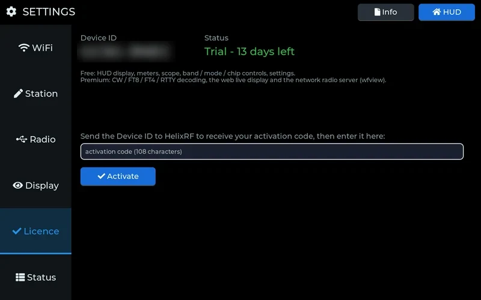
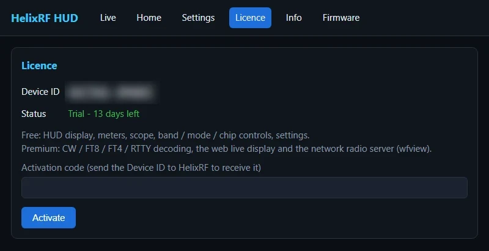
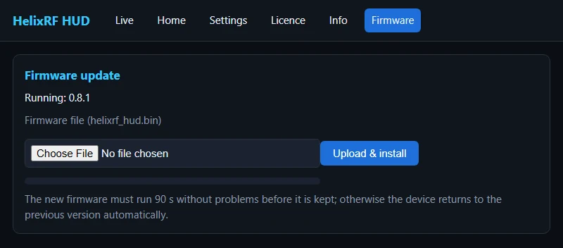

# Getting started

Five steps take you from a new display to a working HUD: download the app,
install it on the display, connect to WiFi, activate your licence and connect
your radio.

## 1. Download

Download the firmware from the link in the product description, or from
**My account → Downloads** on [helixrf.com](https://helixrf.com/my-account/downloads/).

The app is a binary firmware file (`.bin`) that you install on the display.

| File | Use it for |
|---|---|
| `helixrf_hud_full.bin` | First install over USB, at address **0x0**. It holds the boot loader, the partition table and the app. |
| `helixrf_hud.bin` | Updates over WiFi from the web interface. App only. |

!!! warning "Use the right file"
    Never write `helixrf_hud.bin` at address 0x0. It is the app only, and the
    display will not start. Use `helixrf_hud_full.bin` for the first install.

## 2. Install

The display must have an ESP32-P4 chip of silicon revision 3 (v3.1 or later).
Check your display's documentation if you are not sure.

Use the flashing tools at [helixrf.com](https://helixrf.com), or any flashing
tool from Espressif that supports ESP32-P4 silicon revision 3.

1. Connect the display to your PC with a USB cable. Any USB port on the display
   works for this first install.
2. Open the flashing tool in **Chrome** or **Edge**. Other browsers cannot
   reach a serial port.
3. Click **Connect**. When the browser asks, pick the display's serial port and
   allow access.
4. If the tool asks for the chip, select **ESP32-P4**.
5. Set the flash address to **0x0** and choose `helixrf_hud_full.bin`.
6. Click **Program** and wait until the tool reports it is done.
7. Unplug the USB cable and power the display again. The HelixRF logo appears,
   then the main screen.

??? note "Command-line install with esptool"
    With Espressif's esptool:

    ```
    esptool.py --chip esp32p4 write_flash 0x0 helixrf_hud_full.bin
    ```

    Add `-p COMx` (Windows) or `-p /dev/ttyUSBx` (Linux) if more than one serial
    port is connected.

!!! tip "Display does not connect?"
    Put the display in download mode as its manual describes (on most ESP32
    boards: hold **BOOT**, press and release **RESET**, then release **BOOT**),
    and click **Connect** again.

Once the HUD is running and on your WiFi, later versions are installed from the
web interface. See [Update the firmware](#5-update-the-firmware).

## 3. Connect to WiFi

The web interface, firmware updates and the network radio server need WiFi.
The display and radio control work without it.

<figure markdown>
  { loading=lazy }
  <figcaption>Settings → WiFi. The QR code opens the web interface on your phone.</figcaption>
</figure>

1. On the main screen, tap **SETTINGS** (bottom right).
2. Open the **WiFi** tab.
3. Tap **Scan**, then pick your network from the list. Or type the name in
   **Network (SSID)**.
4. Type the **Password**.
5. Tap **Save & Connect**.

When the HUD is connected, the tab shows **Connected to** your network and the
signal strength in dBm. The WiFi icon at the top of the main screen turns green.

To open the web interface, scan the QR code with your phone, or type
**http://helixrf-hud.local/** in a browser on the same network. If that name
does not work on your computer, use the IP address shown under the QR code.

## 4. Activate your licence

The HUD has a **Device ID**, made from the hardware. Your licence key is an
**activation code** (108 characters) made for that Device ID, so it works on
that display only.

Your unique licence key is emailed within 72 hours of successful payment.
Payment and invoicing are handled by our Merchant of Record, Paddle.com Market Ltd.
Nothing is shipped.

<figure markdown>
  { loading=lazy }
  <figcaption>Settings → Licence. The Device ID is blurred in this picture.</figcaption>
</figure>

1. Tap **SETTINGS**, then the **Licence** tab.
2. Note the **Device ID** (for example `K7Q2-M9XD`) and send it to HelixRF:
   type it in the Device ID field at checkout when you order, or email it with
   your order number to [s21rc@helixrf.com](mailto:s21rc@helixrf.com).
3. When the activation code arrives, type it in the **activation code** field.
   Dashes, spaces and upper or lower case do not matter.
4. Tap **Activate**. The status changes to show the licence is active.

You can also activate in the web interface: open the **Licence** page, paste the
code in **Activation code** and click **Activate**. Pasting is easier than typing
108 characters on the screen.

<figure markdown>
  { loading=lazy }
  <figcaption>Licence page in the web interface.</figcaption>
</figure>

If the code is not accepted, the HUD shows one of these messages:

| Message | What to do |
|---|---|
| Enter the activation code first. | The field is empty. Type or paste the code. |
| That is not an activation code. It should be 108 letters and digits. | Part of the code is missing or extra characters were added. Copy it again from the email. |
| The code contains a typing error. Please check it character by character. | One character is wrong. Compare the code with the email. |
| This code does not match this device's ID. | The code was made for another Device ID. Check the Device ID you sent. |
| The code is valid but could not be saved. Please try again. | Tap **Activate** again. If it keeps failing, contact support. |

!!! tip "No key after 72 hours?"
    Check your spam folder first, then
    [contact us](https://helixrf.com/contact/) with your order number.

### 14-day trial

You can try all features for 14 days before you buy, with no registration.
On the **Licence** tab (on the screen or in the web interface), tap
**Start 14-day trial**. The status then shows the days left.

The trial can be started once. Without a licence or a running trial, decoding
and the web live display each run for 2 minutes after every power-on; the
network radio server is off.

## 5. Update the firmware

<figure markdown>
  { loading=lazy }
  <figcaption>Firmware page in the web interface.</figcaption>
</figure>

1. Download the new `helixrf_hud.bin` (see [Download](#1-download)).
2. Open the web interface and click **Firmware**. **Running** shows the version
   now installed.
3. Click **Choose File** and pick `helixrf_hud.bin`.
4. Click **Upload & install**. The bar shows the progress, and the HUD restarts
   when the upload is done.

The new firmware must run for 90 seconds without problems before the HUD keeps
it. If it fails, the HUD goes back to the previous version by itself.

!!! warning
    Keep the HUD powered during the upload.

## 6. Connect your radio

Continue with [Setup](setup/index.md).
