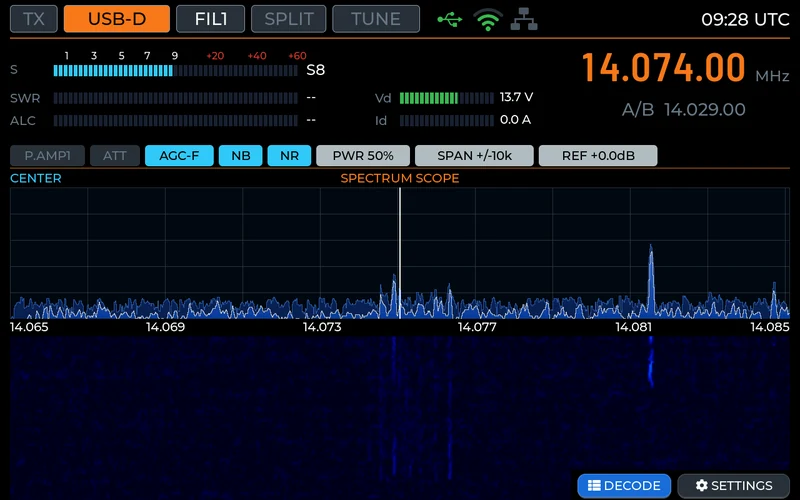

---
hide:
  - navigation
---

Manual · HelixRF USB Display HUD

# HelixRF USB Display HUD

The HelixRF USB Display HUD is a large touch display for your radio. It reads the
radio over USB and shows the frequency, mode, meters and the spectrum scope with
waterfall on a 10.1-inch screen. You can change band, mode and filter from the
screen, decode FT8, FT4, CW and RTTY, and follow the radio from a web browser on
your home network.

This manual matches firmware version **[TODO: x.y]**; use the version menu at the
top to read an older one.

<figure markdown>
  { loading=lazy }
  <figcaption>Main screen: meters, frequency, radio functions and the spectrum scope with waterfall.</figcaption>
</figure>

## What you need

- The display unit: a 10.1-inch, 1280 × 800 touch display (Guition JC8012P4A1C).
  [TODO: say whether HelixRF supplies the display or the customer buys it.]
- A supported radio connected by USB ([see Setup](setup/index.md))
- A 2.4 GHz WiFi network for the web interface, firmware updates and the network radio server
- Your activation code, emailed within 72 hours of payment

## What is included

| Feature | Without a licence | With a licence or the trial |
|---|---|---|
| Frequency, mode, meters, spectrum scope and waterfall | Yes | Yes |
| Band, mode, filter and function control from the screen | Yes | Yes |
| Settings, on the screen and in the web interface | Yes | Yes |
| FT8 / FT4 / CW / RTTY decoding | 2-minute preview after each power-on | Yes |
| Web live display | 2-minute preview after each power-on | Yes |
| Network radio server (for wfview and similar software) | No | Yes |

A 14-day trial with all features is built in. See
[Getting started](getting-started.md#4-activate-your-licence).

## Where to go next

- **[Getting started](getting-started.md)**
  Install, connect to WiFi and activate your licence.

- **[Setup](setup/index.md)**
  Connect your radio and set the radio's menu.

- **[Using the app](using/index.md)**
  Screens, decoding, settings and the web interface.

- **[Release notes](release-notes/index.md)**
  What changed in each version.

Need a hand? Every HelixRF product includes
[free remote support](https://helixrf.com/remote-support/).
[Buy or download the app](https://helixrf.com/product/helixrf-external-usb-radio-display-app/).
