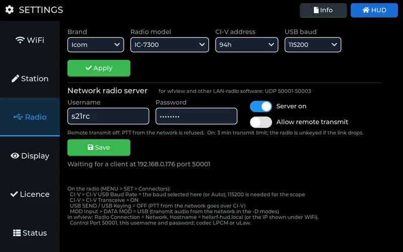
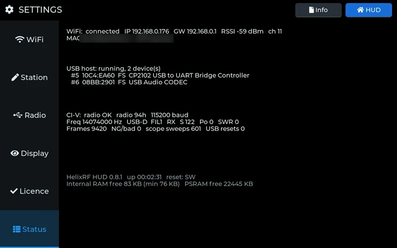

# Setup

## Supported radios

The HUD talks to Icom radios over CI-V on the radio's USB port. Choose the brand
and model in **Settings → Radio**; the HUD then fills in the CI-V address and
baud rate for that model.

| Radio | Connection | Default CI-V address | Notes |
|---|---|---|---|
| Icom IC-7300 | USB (CI-V + audio) | 94h | Tested. |
| Icom IC-7300MK2 | USB (CI-V) | B6h | [TODO: confirm tested and the CI-V address] |
| Icom IC-705 | USB (CI-V) | A4h | [TODO: confirm tested] |
| Icom IC-7610 | USB (CI-V) | 98h | [TODO: confirm tested] |
| Icom IC-9700 | USB (CI-V) | A2h | [TODO: confirm tested] |
| Icom IC-905 | USB (CI-V) | ACh | [TODO: confirm tested] |
| Icom IC-7851 | USB (CI-V) | 8Eh | [TODO: confirm tested] |
| Icom IC-R8600 | USB (CI-V) | 96h | [TODO: confirm tested] |
| Yaesu FT-710 | USB (CAT) | — | In the model list; CAT control comes in a later update. |
| Kenwood TS-890S | USB (CAT) | — | In the model list; CAT control comes in a later update. |

Decoding uses the radio's USB audio (receive audio), so it needs a radio with a
built-in USB sound card, such as the IC-7300.

## Connect the radio

1. Connect the radio's USB port to the HUD's USB host port with a USB cable.
   [TODO: name or picture of the HUD port to use.]
2. Switch the radio on. No driver is needed; the HUD finds the radio by itself.
3. On the HUD, tap **SETTINGS** and open the **Radio** tab.
4. Choose the **Brand** and **Radio model**.
5. Check the **CI-V address** and **USB baud**. They must match the radio's menu
   (see below).
6. Tap **Apply**.

The USB icon at the top of the main screen turns green when the radio answers.

<figure markdown>
  { loading=lazy }
  <figcaption>Settings → Radio. The bottom of the tab repeats the radio menu settings.</figcaption>
</figure>

| Setting | What it does |
|---|---|
| **Brand** | Icom, Yaesu or Kenwood. Filters the model list. |
| **Radio model** | Sets the default CI-V address and baud rate for that model. |
| **CI-V address** | The radio's CI-V address. Use the model's default unless you changed it in the radio. |
| **USB baud** | Serial speed: 4800 to 115200. Must match the radio's CI-V USB baud rate. |
| **Serial format** (web only) | 8N1 or 8N2, for Yaesu and Kenwood radios. |

## Radio menu settings

On the IC-7300, open **MENU → SET → Connectors** and set:

| Radio menu item | Setting | Why |
|---|---|---|
| **CI-V → CI-V USB Baud Rate** | The same as **USB baud** on the HUD, or **Auto** | 115200 is needed for the spectrum scope. |
| **CI-V → CI-V Transceive** | **ON** | The radio reports changes made on its front panel. |
| **USB SEND / USB Keying** | **OFF** | Transmit from the network goes over CI-V. |
| **MOD Input → DATA MOD** | **USB** | Transmit audio from the network in the -D modes. Only needed for the network radio server. |

[TODO: menu paths for the other supported radios.]

## Network radio server (wfview)

The HUD can act as a network radio, so you can run wfview or similar LAN-radio
software on a PC without a cable to the radio. It passes the radio's control,
spectrum scope and audio (48 kHz) over your network. Needs a licence or the trial.

1. In **Settings → Radio**, under **Network radio server**, type a **Username**
   and **Password**.
2. Switch **Server on**.
3. Tap **Save**. The line below shows **Waiting for a client at** the HUD's
   address, port 50001.
4. In wfview, set **Radio Connection** to **Network**, **Hostname** to
   `helixrf-hud.local` (or the HUD's IP address), **Control Port** to `50001`,
   the same username and password, and the codec to **LPCM** or **uLaw**.

The HUD uses UDP ports 50001 to 50003.

### Remote transmit

**Allow remote transmit** is off by default. While it is off, transmit (PTT)
requests from the network are refused, so the PC can only listen.

When you switch it on:

- Each transmission is limited to 3 minutes.
- The radio is unkeyed if the network link drops.
- The network icon on the main screen turns red while the network keys the radio.

!!! warning
    Only allow remote transmit when you, or another licensed operator, can watch
    the station. You are responsible for every transmission.

For FT8 with WSJT-X on the PC, use wfview's virtual serial port or rigctld for
CAT and PTT. [TODO: tested WSJT-X settings.]

## Troubleshooting

Open **Settings → Status** to see what the HUD sees: WiFi, the USB devices
found, the CI-V link and the firmware.

<figure markdown>
  { loading=lazy }
  <figcaption>Settings → Status with a working IC-7300: two USB devices (CI-V bridge and USB audio) and "radio OK".</figcaption>
</figure>

| Symptom | Fix |
|---|---|
| USB icon red, **USB host** shows no devices | Check the cable and that the radio is on. Use the HUD's USB host port. Try another USB cable. |
| USB devices listed, but no radio (CI-V shows no reply) | Check **USB baud** and **CI-V address** match the radio's menu. Set **CI-V Transceive** to **ON**. |
| Frequency shows but no spectrum scope | Set **CI-V USB Baud Rate** to 115200 (or Auto) on the radio and **USB baud** to 115200 on the HUD. |
| Decode page shows no audio | The radio's USB audio codec must be listed under **USB host** in **Settings → Status**. |
| FT8 / FT4 decodes nothing | The clock must be right: FT8 needs UTC within about a second. The HUD sets its clock from the internet, so it needs WiFi. |
| Display flickers or the radio's USB drops while a PC is also plugged into the HUD | This is a ground loop between the PC and the radio. Unplug the PC, or use a USB isolator. The HUD reconnects to the radio by itself and counts the drops as **USB resets** on the Status tab. |
| `helixrf-hud.local` does not open | Use the IP address from **Settings → WiFi** instead. Some computers and phones do not support `.local` names. |
| Touch is offset | Run **Calibrate touch** in **Settings → Display**. See [Using the app](../using/index.md#display). |
| wfview cannot log in | Check the username and password in **Settings → Radio**, that **Server on** is set, and that the HUD has a licence or a running trial. |
