# Using the app

## Main screen

The main screen shows the radio at a glance. Most items are also buttons: tap
them to change the radio.

<figure markdown>
  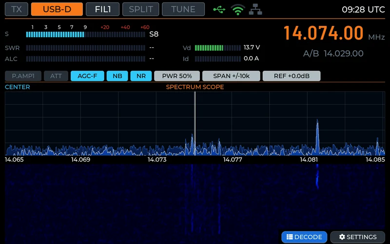{ loading=lazy }
  <figcaption>Main screen with the Bars meter face.</figcaption>
</figure>

### Top bar

| Item | Shows | Tap to |
|---|---|---|
| **TX** | Red while the radio transmits. | — |
| Mode (for example **USB-D**) | The radio's mode. **-D** means data mode is on. | Open the [mode panel](#mode-and-filter). |
| **FIL1** / **FIL2** / **FIL3** | The selected filter. | Open the mode panel. |
| **SPLIT** | Amber while split is on. | Switch split on or off. |
| **TUNE** | Green while the antenna tuner is on; **TUNING** while it tunes. | Tap: tuner on or off. Touch and hold: start a tune (the radio transmits a carrier). |
| USB icon | Green: the radio is answering. Red: no radio or no CI-V reply. | — |
| WiFi icon | Signal strength of the WiFi link. | — |
| Network icon | Only shown when the network radio server is on. Grey: waiting. Blue: a client is connected. Red: the network is keying the radio. | — |
| Clock | UTC, set from the internet. Shows `--:--` until the clock is known. | — |

### Meters and frequency

| Item | Shows | Tap to |
|---|---|---|
| **S** | Signal strength, S1 to S9+60. Becomes **Po** (output power) while transmitting. | — |
| **SWR**, **ALC** | Transmit meters. | — |
| **Vd**, **Id** | The radio's supply voltage and drain current. | — |
| Frequency | The main VFO frequency in MHz. | Open the [band panel](#band). |
| **A/B** | The other VFO's frequency. | Swap VFO A and B. |

### Function chips

| Chip | Tap to |
|---|---|
| **P.AMP1** / **P.AMP2** | Step the preamp: off → P.AMP1 → P.AMP2 → off. (IC-9700 and IC-905: one preamp.) |
| **ATT** | Attenuator on or off (20 dB; 10 dB on the IC-9700 and IC-905). |
| **AGC-F** / **AGC-M** / **AGC-S** | Step the AGC: fast → mid → slow. |
| **NB** | Noise blanker on or off. |
| **NR** | Noise reduction on or off. |
| **PWR** | Shows the RF power setting. Display only. |
| **SPAN** | Shows the scope span. Display only. |
| **REF** | Shows the scope reference level. Display only. |

A blue chip is on; a grey chip is off.

### Spectrum scope and waterfall

The scope shows the radio's own spectrum data. **CENTER** or **FIX** at the top
left is the radio's scope mode. The white line marks the operating frequency.

**Tap the spectrum or the waterfall to tune there** (in 100 Hz steps).

The **DECODE** button opens the [decode screen](#decode-screen) and **SETTINGS**
opens [Settings](#settings).

## Meter faces

There are three meter faces. **Swipe left or right over the meter area** (between
the two orange lines) to switch. Choose the face shown at start-up in
**Settings → Display → Main screen face at start-up**.

| Face | Look |
|---|---|
| Bars | Bar meters for S, SWR, ALC, Vd and Id (picture above). |
| Analog | A dark dial with one needle: S on receive, Po on transmit. |
| Vintage | The same dial with a warm, back-lit look. |

<figure markdown>
  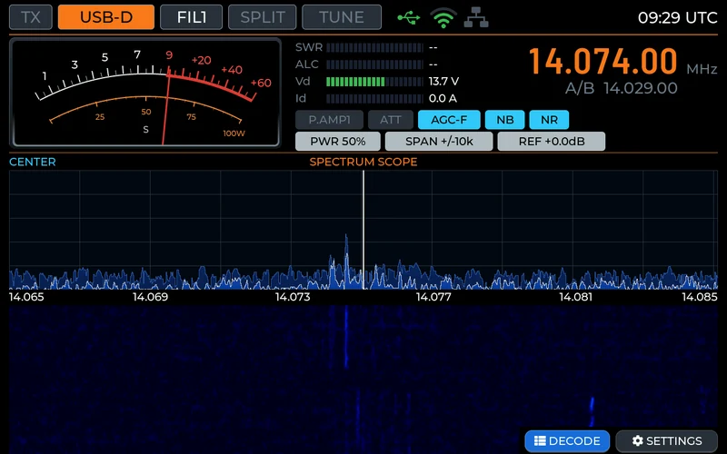{ loading=lazy }
  <figcaption>Analog face.</figcaption>
</figure>

<figure markdown>
  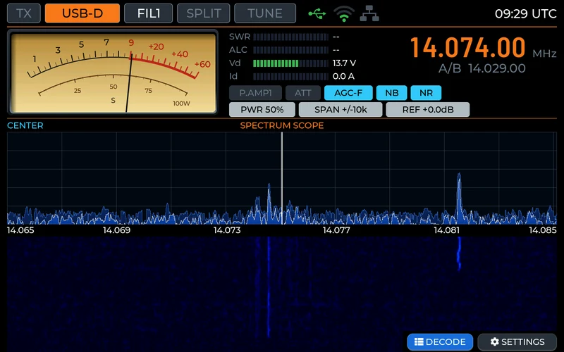{ loading=lazy }
  <figcaption>Vintage face.</figcaption>
</figure>

## Band, mode and frequency panels

A panel opens over the meters. Tap anywhere else to close it; it also closes
after 10 seconds without a touch.

### Band

Tap the frequency to open the band panel.

<figure markdown>
  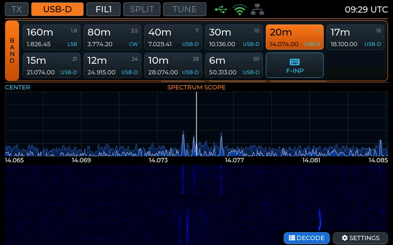{ loading=lazy }
  <figcaption>Band panel. The current band is orange.</figcaption>
</figure>

Each button shows the band, the frequency and the mode you will go to. The HUD
remembers the last frequency and mode you used on each band. For bands you have
not used since power-on, it reads the radio's band stacking register. Only the
bands your radio model has are shown.

Tap **F-INP** to type a frequency.

### Frequency keypad (F-INP)

<figure markdown>
  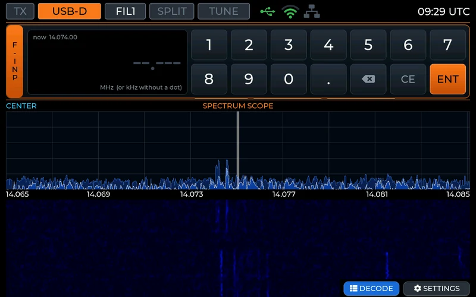{ loading=lazy }
  <figcaption>Frequency keypad.</figcaption>
</figure>

1. Type the frequency. With a decimal point it is in MHz (`14.074`); without one
   it is in kHz (`14074`).
2. Tap **ENT** to tune. **⌫** deletes one digit; **CE** clears the entry.

The **now** line shows the current frequency. Frequencies outside 30 kHz to
11 GHz show **out of range**.

### Mode and filter

Tap the mode or filter badge to open the mode panel.

<figure markdown>
  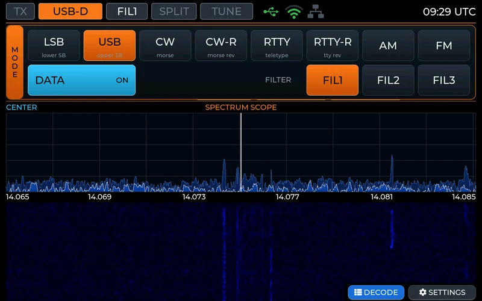{ loading=lazy }
  <figcaption>Mode panel.</figcaption>
</figure>

| Button | Does |
|---|---|
| **LSB**, **USB**, **CW**, **CW-R**, **RTTY**, **RTTY-R**, **AM**, **FM** | Set the mode. |
| **DATA** | Data mode on or off (for example USB → USB-D). |
| **FIL1**, **FIL2**, **FIL3** | Select the filter. |

## Decode screen

Tap **DECODE** on the main screen. The decoder uses the radio's USB receive audio.
Tap **HUD** to go back and **Clear** to empty the list.

Choose the mode with the buttons along the top: **FT8**, **FT4**, **RTTY** and
**CW**. Greyed-out modes (JT65, JT9, WSPR, Q65, FST4, MSK144) are not available
yet. The HUD remembers the last mode.

Decoding needs a licence or the trial. Without one, it runs for 2 minutes after
each power-on, then shows **Preview ended**.

### FT8 and FT4

<figure markdown>
  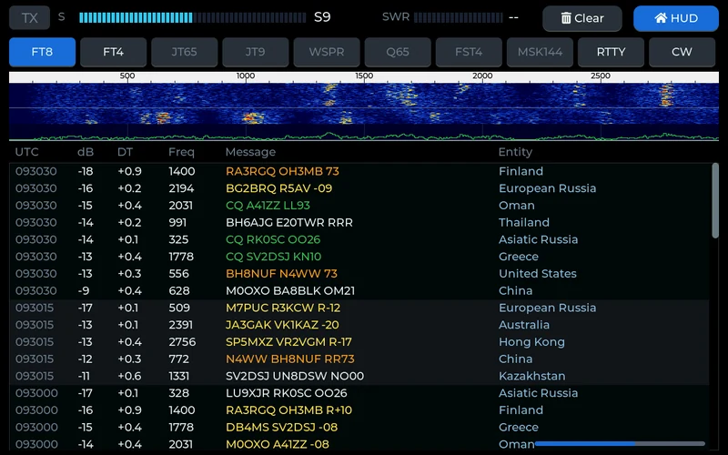{ loading=lazy }
  <figcaption>FT8 decoding.</figcaption>
</figure>

The waterfall shows the audio passband (0 to about 3000 Hz). Each decode cycle
adds lines to the list:

| Column | Shows |
|---|---|
| **UTC** | Start time of the cycle. |
| **dB** | Signal-to-noise ratio. |
| **DT** | Time offset in seconds. |
| **Freq** | Audio frequency in Hz. |
| **Message** | The decoded message. |
| **Entity** | The DXCC country of the sending station. |

Messages are coloured: **green** for CQ calls, **yellow** for signal reports,
**orange** for 73 and RR73. Messages with your own call sign (set in
**Settings → Station**) are highlighted.

FT8 and FT4 need the correct time. The HUD sets its clock from the internet over
WiFi.

### CW

<figure markdown>
  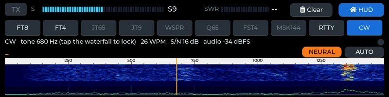{ loading=lazy }
  <figcaption>CW decoding (top of the screen).</figcaption>
</figure>

The status line shows the tone frequency, the speed in WPM, the signal-to-noise
ratio and the audio level. The decoder follows the strongest signal near the
radio's CW pitch.

- **Tap the waterfall** on a signal to lock the decoder to that tone.
- Tap **AUTO** to unlock it again.
- **NEURAL** / **CLASSIC** switches between the two CW decoders. NEURAL gives far
  less junk text from noise; CLASSIC is the traditional decoder. Both do well on
  clean signals.

### RTTY

<figure markdown>
  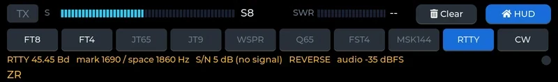{ loading=lazy }
  <figcaption>RTTY decoding (top of the screen).</figcaption>
</figure>

The status line shows the speed (45.45 Bd), the mark and space tones, the
signal-to-noise ratio, **REVERSE** when the radio is in RTTY-R, and the audio
level. Tune the signal onto the mark and space tones shown.

## Settings

Tap **SETTINGS** on the main screen. The tabs are on the left. **Info** opens the
[Info screen](#info-screen) and **HUD** goes back to the main screen. Settings
are saved in the HUD and kept after power-off.

| Tab | Use it to |
|---|---|
| **WiFi** | Connect to your WiFi. See [Getting started](../getting-started.md#3-connect-to-wifi). |
| **Station** | Set your own call sign. |
| **Radio** | Choose the radio and set up the network radio server. See [Setup](../setup/index.md). |
| **Display** | Backlight, scope colours, meter face, touch calibration. |
| **Licence** | Activate a licence or start the trial. See [Getting started](../getting-started.md#4-activate-your-licence). |
| **Status** | Check WiFi, USB, CI-V and firmware. See [Troubleshooting](../setup/index.md#troubleshooting). |

### Station

<figure markdown>
  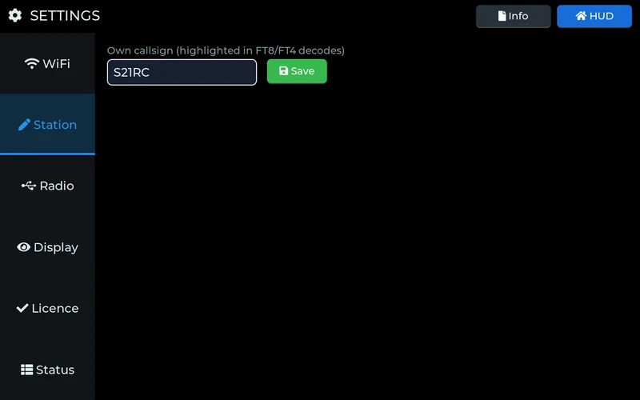{ loading=lazy }
  <figcaption>Settings → Station.</figcaption>
</figure>

Type your call sign in **Own callsign** and tap **Save**. Allowed characters are
A–Z, 0–9 and `/`. FT8 and FT4 messages with your call sign are highlighted.

### Display

<figure markdown>
  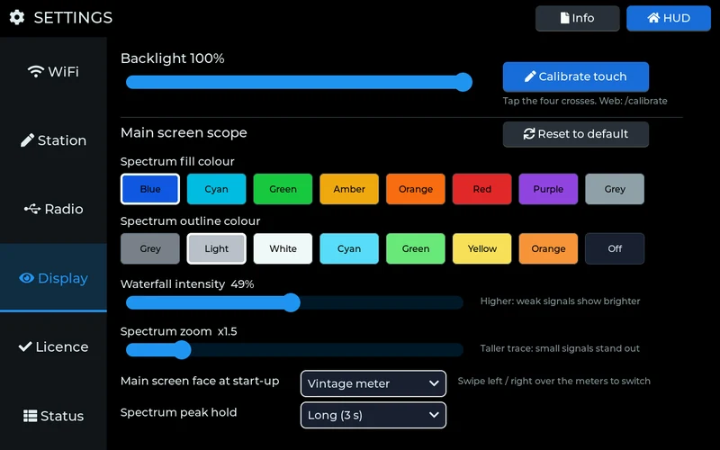{ loading=lazy }
  <figcaption>Settings → Display.</figcaption>
</figure>

| Setting | What it does |
|---|---|
| **Backlight** | Screen brightness. |
| **Calibrate touch** | Starts the touch calibration (see below). |
| **Spectrum fill colour** | Colour under the spectrum trace: Blue, Cyan, Green, Amber, Orange, Red, Purple or Grey. |
| **Spectrum outline colour** | Colour of the trace line: Grey, Light, White, Cyan, Green, Yellow, Orange, or Off. |
| **Waterfall intensity** | Higher makes weak signals brighter in the waterfall. 50 % is neutral. |
| **Spectrum zoom** | ×1.0 to ×4.0. A taller trace makes small signals stand out. |
| **Main screen face at start-up** | Bars, Analog or Vintage meter. |
| **Spectrum peak hold** | Off, Short (1 s) or Long (3 s). |
| **Reset to default** | Puts the scope settings back to the factory values. |

### Touch calibration

Touch works out of the box. If touches land in the wrong place, calibrate:

1. Tap **Settings → Display → Calibrate touch**, or open
   `http://helixrf-hud.local/calibrate` in a browser.
2. A cross appears in each corner in turn. Tap and hold the centre of the cross
   briefly, four times.

If nothing is touched for 45 seconds, the calibration is cancelled and the old
settings stay.

<figure markdown>
  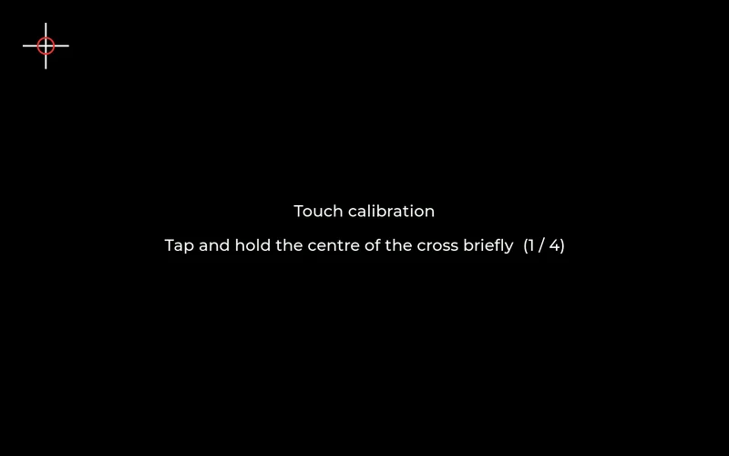{ loading=lazy }
  <figcaption>Touch calibration, first of four points.</figcaption>
</figure>

### Status

<figure markdown>
  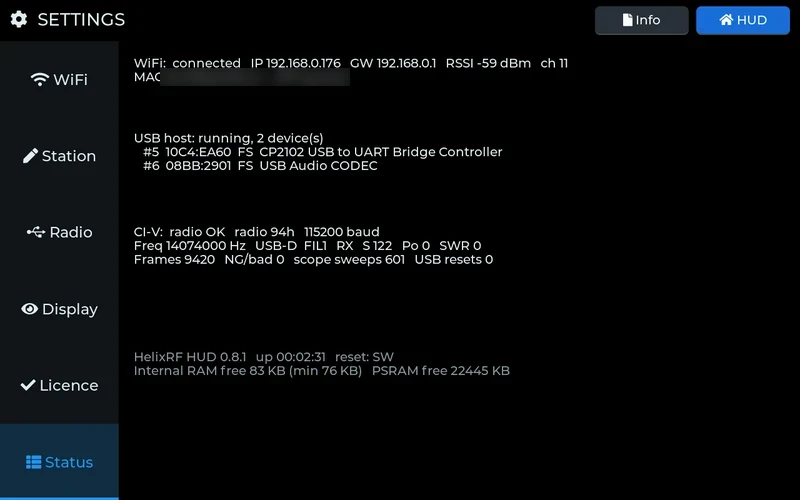{ loading=lazy }
  <figcaption>Settings → Status.</figcaption>
</figure>

| Section | Shows |
|---|---|
| WiFi | Connection, IP address, gateway, signal (RSSI), channel, MAC address, and whether the clock is synchronised (**NTP synced**). |
| USB host | The USB devices found. An IC-7300 shows two: the CP2102 USB-to-UART bridge (CI-V) and the USB Audio CODEC. |
| CI-V | Link state, radio address, baud rate, frequency, mode and meter values, frame counters and **USB resets** (automatic reconnects). |
| Firmware | Version, uptime, reason for the last restart, and free memory. |

## Info screen

Tap **Info** in Settings.

<figure markdown>
  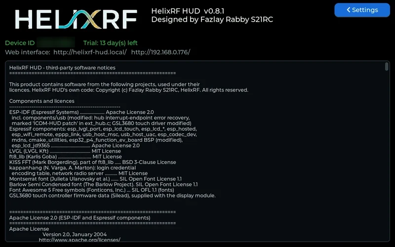{ loading=lazy }
  <figcaption>Info screen. The Device ID is blurred in this picture.</figcaption>
</figure>

It shows the firmware version, the Device ID and licence state, the web interface
addresses, and the third-party software notices. Tap **Settings** to go back.

## Web interface

Open **http://helixrf-hud.local/** (or the HUD's IP address) in a browser on the
same network. The menu at the top has **Live**, **Home**, **Settings**,
**Licence**, **Info** and **Firmware**.

### Live

<figure markdown>
  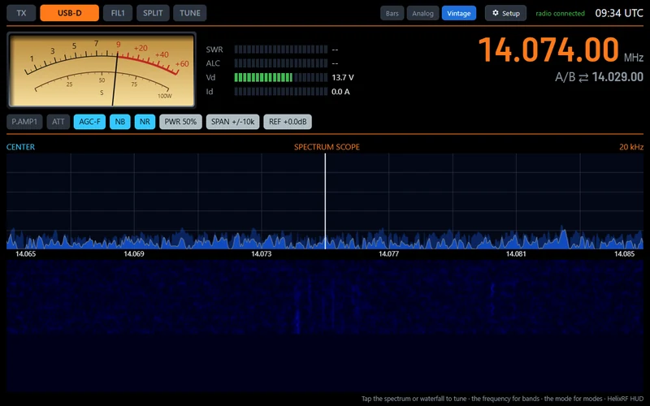{ loading=lazy }
  <figcaption>Live page in a desktop browser.</figcaption>
</figure>

The Live page mirrors the main screen in your browser, and you can work it the
same way:

- Tap or click the spectrum or waterfall to tune.
- Click the frequency for the band panel, and the mode for the mode panel.
- Click **P.AMP**, **ATT**, **AGC**, **NB** or **NR** to switch them.
- **Bars**, **Analog** and **Vintage** choose the meter face in the browser.
- **Setup** opens the other web pages.

The status text next to **Setup** shows **radio connected**, or
**HUD offline - reconnecting...** when the link drops. Up to two browsers can
show the Live page at the same time. Needs a licence or the trial; without one
it runs for 2 minutes after each power-on.

<figure markdown>
  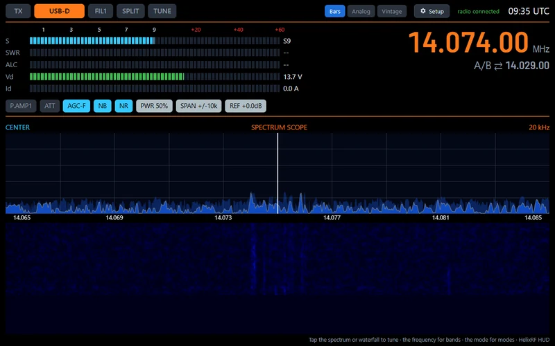{ loading=lazy }
  <figcaption>Live page with the Bars face.</figcaption>
</figure>

<figure markdown>
  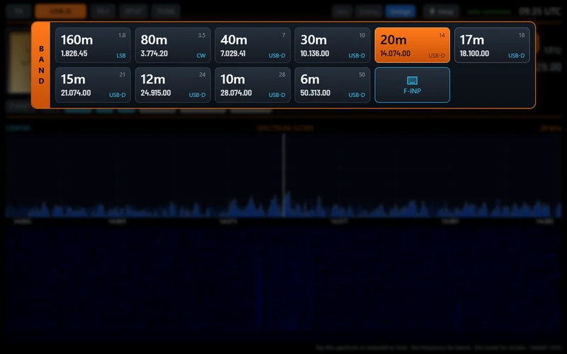{ loading=lazy }
  <figcaption>Band panel in the browser.</figcaption>
</figure>

The page also works on a phone or tablet; on a narrow screen the parts stack
vertically.

### Home

<figure markdown>
  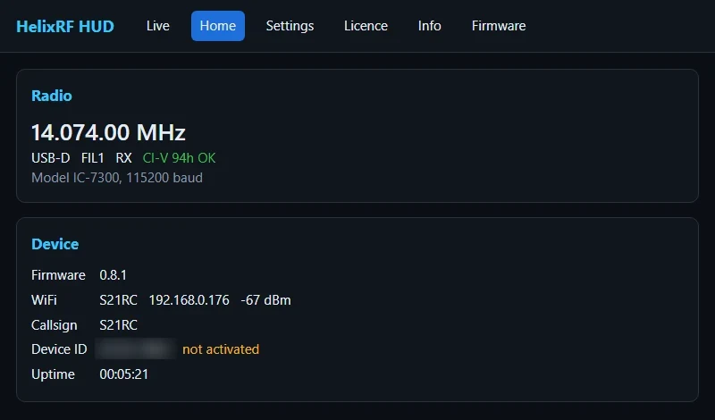{ loading=lazy }
  <figcaption>Home page. The Device ID is blurred in this picture.</figcaption>
</figure>

**Radio** shows the frequency, mode, filter, receive or transmit, and whether
CI-V is working. **Device** shows the firmware version, WiFi, call sign,
Device ID with the licence state, and uptime.

### Settings

<figure markdown>
  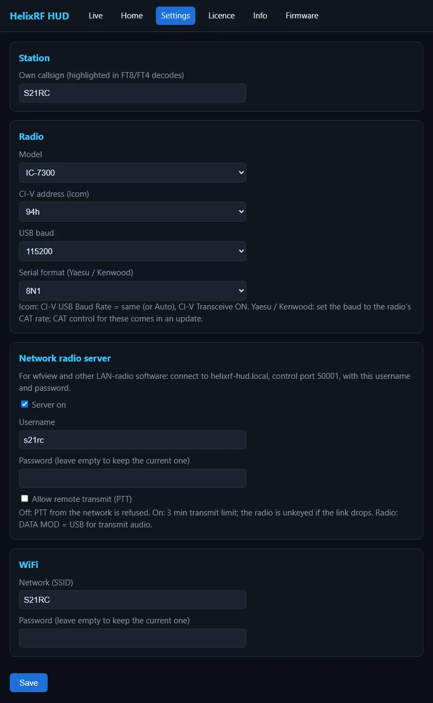{ loading=lazy }
  <figcaption>Settings page in the web interface.</figcaption>
</figure>

The same settings as on the screen, in four sections: **Station**, **Radio**,
**Network radio server** and **WiFi**. Change what you need and click **Save**
at the bottom. Leave a password field empty to keep the current password.

### Licence, Info and Firmware

- **Licence**: Device ID, status, and the activation code field. See
  [Getting started](../getting-started.md#4-activate-your-licence).
- **Info**: firmware version, Device ID and the open-source licences.
- **Firmware**: install a new firmware file. See
  [Getting started](../getting-started.md#5-update-the-firmware).

<figure markdown>
  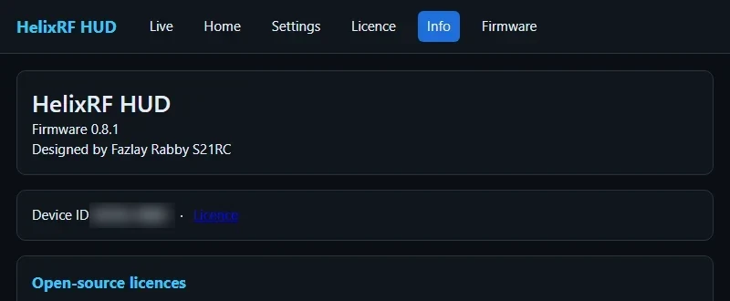{ loading=lazy }
  <figcaption>Info page (top). The Device ID is blurred in this picture.</figcaption>
</figure>

## Keyboard shortcuts

In the web interface, while the frequency keypad is open:

| Key | Does |
|---|---|
| <kbd>0</kbd> to <kbd>9</kbd>, <kbd>.</kbd> | Type the frequency. |
| <kbd>Enter</kbd> | Tune (**ENT**). |
| <kbd>Backspace</kbd> | Delete one digit. |
| <kbd>Delete</kbd> | Clear the entry (**CE**). |
| <kbd>Esc</kbd> | Close the panel. |
